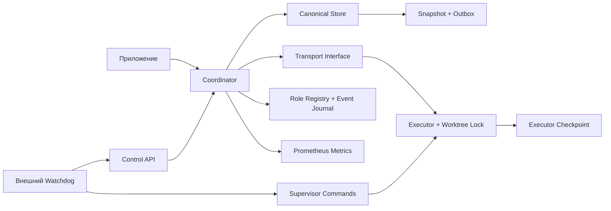
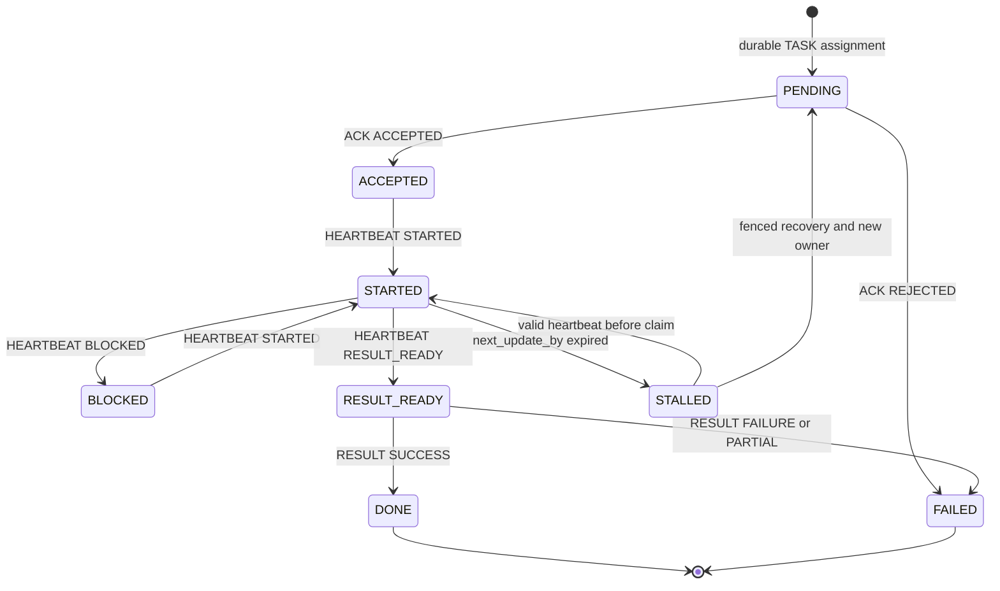

# Как устроено приложение

<!-- shadow-pilot-live-entrypoint -->
## Read-only shadow pilot в coordd (WP-SV-07, #70)

Точная команда `coordd shadow-pilot run` выполняет отдельный путь с возвратом
process exit code до daemon startup. Он не получает factories canonical store,
role registry или daemon host. Неизвестные подкоманды, daemon-флаги и смешанные
режимы отклоняются. Startup probes наблюдают успешные открытия store, получение
двух daemon locks, выбор адаптера и завершённый dispatch; shadow-отчёт требует
нулевых store/lock счётчиков и одного успешного dispatch. Счётчики относятся к
локальному coordd; они не доказывают поведение произвольного удалённого процесса.

`telepathyShadowAgentAdapter` оборачивает существующий MCP `telepathy.Process`;
`internal/shadowpilot` остаётся transport-neutral. Live-конструктор запускает
проверенный Telepathy 0.8.0 client/server contract. Другая версия сервера даёт
отказ; совместимость с установленными более новыми плагинами не предполагается.
Tools `send_message` и `read_messages` передают типизированные JSON envelopes.
Reply address берётся из MCP `list_peers`; optional `--reply-to` проверяется
против фактического sender. Свободный текст не является результатом. Корреляция связывает domain, dispatch,
run, assignment, canonical AgentID, SessionID, generation, candidate/baseline SHA
и input digest до `ShadowExecution.Complete`. Digest результата проверяется.
Это read-only payload binding, не новый authentication или production command
boundary; текст MCP сам по себе не является криптографическим peer attestation.

Fixture требует immutable SHA, существующий локальный commit object и запрет
всех внешних записей. SHA baseline совпадает с candidate для первого пилота.
`--reviewer-agent` задаёт назначенную identity для admission executor, но не
утверждает, что Review выполнен. Этот запуск не принимает себя, не выдаёт
`ADMIT_P0_3` и не обладает authority на production writes.

Десять существующих model dimensions сохраняются в `COMPARISON.json`.
Неподтверждённые independence, rationale, readiness и live crash deduplication
сохраняются как `NOT_EVALUATED` с причиной. Проверка finding identity сравнивает
ID инвариантов fixture и результата; она не выдаётся за независимую оценку
правильности rationale. Completed-checkpoint JSON replay проверяет model
`RESUME_GRAPH`, но не заменяет live process restart. `REPORT.json` содержит
валидированный model report и отдельный итог pilot `NOT_EVALUATED`. Поле
`canonical_revision: 1` model report обозначает только локальный shadow snapshot,
не прочитанную production canonical revision. Независимые Review/Audit остаются
внешними gates; их acceptance не производится этим run.

Artifacts пишутся однократно в новую директорию под project `.scratch/tmp`;
существующий output и symlink ancestors отклоняются. JSON-кодировка YAML-файлов
сохраняет один digest preimage. Provenance связывает HEAD, digest текущего binary
и command invocation, subjects/input/result, adapter/client version, identities,
timestamps, startup counters и digests pre-seal artifacts. `Seal` и `Verify`
предшествуют построению и Validate report. Чтобы избежать циклических хэшей,
bundle связывает pre-seal artifacts; `INTEGRITY.sha256` дополнительно связывает
manifest и report, но не себя. Ошибка binding оставляет refusal без completed
result, sealed bundle или report.

Пример запуска после отдельной проверки доступного server и responder:

```sh
coordd shadow-pilot run --input testdata/shadow-validation/input.yaml \
  --adapter telepathy --executor-agent codex --executor-session workspace-c03 \
  --reviewer-agent opencode \
  --telepathy-server /absolute/path/to/verified-0.8.0/server.mjs \
  --telepathy-home /absolute/path/to/selected/telepathy-home \
  --output .scratch/tmp/wp-sv-07-live-run
```

Transport receipt означает dispatch, а не принятие или завершение задания.
Отсутствие коррелированного результата завершается отказом по deadline.
Unit/MCP protocol tests не являются evidence реального c03 live run.

## Completion candidates и GitHub observations

Кандидаты завершения проходят проверку по canonical Task, Run, exact subject, Action Map, workflow catalog, completion policy и watchdog до canonical commit. Публикация следует после commit; отклонённый кандидат не создаёт canonical event или external action.

Типизированные external actions маршрутизируются по существующему lifecycle. В этом срезе GitHub family поддерживает только read-only наблюдения Issue, pull request и pipeline через in-memory fixtures. Evidence помечается `FIXTURE_NOT_LIVE` и не может подтверждать production readiness. Legacy объекты без provenance остаются непроверенными.

Этот документ описывает текущее устройство кода и явно разделяет:

- действующий legacy runtime;
- реализованный canonical core;
- ещё не подключённые production paths.

Целевое направление и статус компонентов приведены в [TARGET-ARCHITECTURE.md](TARGET-ARCHITECTURE.md).

Нормы задают Accepted ADR и TASK-MODEL. Этот документ не создаёт новых норм.
При расхождении документа с принятым и покрытым тестами кодом документ
исправляется по R101.

В legacy-разделах `Coordinator` означает текущий Run coordinator.
`coordd` означает standalone daemon, владеющий canonical state.

`coord` разделяет подтверждение транспорта, подтверждение принятия задачи
и подтверждение результата. Сообщение доставлено — это ещё не задача принята.

Диаграмма ниже показывает компоненты, существующие в текущем репозитории, и
целевое направление владения. Она не означает, что все стрелки уже образуют
единый production path. Legacy CLI/localchat и standalone Telepathy paths
продолжают владеть отдельными runtime-файлами. Production mutations ещё не
полностью проходят через canonical daemon command path.



<!-- canonical-persistence -->
<!-- daemon-runtime -->
## Идентичность

В текущем wire/storage протоколе `Run.Task` и `Envelope.Task` — legacy task
label для корреляции исполнения; его исторические значения не гарантируют
идентичность будущей канонической Task и не преобразуются автоматически в
`TaskID` (см. [TASK-MODEL.md](TASK-MODEL.md) TM-03). `run` обозначает исполнение,
`attempt` — номер запуска, `target_sha` — базовый commit worktree. Повторная
доставка не изменяет эти поля. `owner_session` обозначает текущую сессию,
`fence` — поколение владения. Recovery сохраняет attempt, увеличивает fence и
меняет owner.

`agent_id` — доверенная стабильная identity, привязанная оператором к сессии.
Одно agent_id может иметь несколько session addresses. Проверка независимости
AUDITOR использует agent_id и историю владельцев, а не название модели или адрес.

`coordd` открывает versioned `canonical.json`, представляющий единый
`CanonicalState`. В текущую canonical schema входят: Tasks и Runs; Domain
Events; Inbox receipts и Outbox; AgentSession projections и append-only
AgentSessionEvents; типизированные ReviewResult и AuditResult; canonical
Discussion Graph. Startup валидирует schema version, внутренние инварианты и
связи между объектами. Canonical transition и связанные с ним Domain Event,
обязательный Inbox receipt и необходимый Outbox фиксируются одной durable
mutation, когда эти элементы предусмотрены конкретной canonical операцией.
Store-level atomic boundary реализована; наличие production caller path
указывается отдельно для каждого компонента.

`coordd` также открывает `roles.json` (role registry). Процесс удерживает
`namespace.lock`, storage locks `canonical.json.lock` и `roles.json.lock` и
временный compatibility lock `runs.json.lock`. Legacy `runs.json` только
читается при startup: активный Run или неизвестная schema оставляет daemon в
diagnostic-only `NOT_READY`, импорта нет.

Основные canonical срезы P0-2 реализованы: Task aggregate и Task.Fence,
AgentSession projection/history/binding, authenticated canonical agent command
boundary (`CanonicalStore.ApplyAgentCommand`), ReviewResult и AuditResult,
canonical Discussion Graph core, atomic canonical persistence. Согласно
`docs/ROADMAP.md`, ограниченная Shadow Validation и приёмка границы этапа
остаются открытыми. Production Task command path, операторские команды,
P0-3 production integration остаются открытыми. `fsm.Run.TaskID` является
отдельной связью и может быть пустым только у переходного legacy Run;
`Run.Task` не переинтерпретируется.

У проекта пока несколько отдельных runtime state owners. Локальный
`cmd/coord`/localchat пишет legacy `runs.json`, `rooms.json`, `connection.json`,
`answers/<run>.json`, `executors/<run>.json`, `events.jsonl`, `owner.key` и
credential-файлы `clients/<session>-<generation>.json`. Standalone
`cmd/coord-telepathy` host/worker пишет `runs.json`, `binding.json`,
`executor.json` и `task.json`; эти файлы принадлежат transport/executor
сценарию, а не canonical Task model. Rooms history export создаёт отдельную
Git-проекцию `.coord-history` и `history/projection.json`, а `daemon.log` —
append-only диагностический журнал локального CLI, не источник состояния. Demo,
examples, integration harness и тесты имеют собственные пути записи и не считаются
production runtime. Эти legacy и standalone процессы не входят в namespace lock
`coordd`; production mutations должны перейти на daemon command path в P0-3.

## Legacy Run execution lifecycle

Эта диаграмма описывает текущую FSM `fsm.Run`. Она не является канонической
Task Stage/Status моделью. Каноническая Task workflow использует отдельные оси
Stage и Status и описана в `TASK-MODEL.md` и `TARGET-ARCHITECTURE.md`.



Это схема типичного пути, а не исчерпывающий список переходов. Прямой `RESULT`
до `RESULT_READY` запрещён. Внутренний `ResumeStatus` позволяет восстановить
состояние до STALLED. Deadline может завершить любой нетерминальный run как FAILED.
Полную таблицу допустимых heartbeat переходов проверяет `fsm/fsm_test.go`.

<!-- canonical-agent-command-boundary -->
## Canonical agent command boundary

Каноническая граница `CanonicalStore.ApplyAgentCommand` реализована и проверена
тестами. Она проверяет: signed authenticated frame и локального получателя;
активную AgentSession; generation и текущий ключ; соответствие AgentID
назначению Run; Task, Run, Fence и Attempt; role и Stage; независимость ролей;
replay и ExpectedRevision; допустимость перехода. Для новой команды переход
Task/Run, Domain Event, Inbox receipt и Outbox фиксируются одной canonical
mutation.

Production caller path к `ApplyAgentCommand` ещё не подключён. Текущий реальный
вход продолжает использовать legacy `Coordinator.Handle`; production CLI и
Telepathy write paths остаются частью P0-3.

<!-- canonical-discussion-graph -->
## Canonical Discussion Graph

`CanonicalState` содержит принадлежащие Task типизированные Discussion nodes и
edges. Canonical validation проверяет: допустимые типы узлов и связей;
обязательные Actor и Role; принадлежность Task; ссылочную целостность;
ограничения специальных типов и связей; согласованность startup snapshot и
transition. Для agent command Actor выводится из проверенной AgentSession и
сохранённого назначения Run, а не принимается из тела команды.
Canonical core реализован. Production command path, read-only projection,
proposed Owner Console и proposed Decision Resolver не реализованы.

<!-- canonical-review-audit-results -->
## Canonical ReviewResult and AuditResult

Canonical model содержит типизированные `ReviewResult` и `AuditResult`. Приём
результата фиксирует одной durable mutation: typed result, переход Task,
terminal role Run, Domain Event, Inbox receipt, `RESULT_ACK` в Outbox. Startup
и transition validation проверяют принадлежность Task и Run, роль, Attempt,
допустимые verdict и references, независимость Reviewer и Auditor по стабильному
AgentID и истории Executor. Production agent/CLI caller path пока не подключён.

## Durable commit перед side effect

### Legacy Run path

В legacy Run path назначение и outbox сохраняются до отправки TASK. При
рестарте недоставленный Outbox повторяется. Executor устраняет повторное
выполнение по task/run/attempt/fence.

Store сериализует изменения, записывает snapshot и только после этого
публикует новую версию памяти. Входные slices/maps/pointers копируются, чтобы
вызывающий код и persistence не могли изменить опубликованное состояние.

### Canonical command model

В canonical command model переход Task/Run, Domain Event, Inbox receipt и
необходимый Outbox фиксируются одной `UpdateCanonical`. Новая версия памяти
публикуется только после успешного durable Save. При неопределённом durable
failure требуется повторное открытие состояния. Canonical transaction
реализована на store model, но production caller path к `ApplyAgentCommand` ещё
не подключён.

Файлы создаются с правами 0600; запись использует temp, fsync, atomic rename
и fsync родительской папки. На Linux, macOS, DragonFly BSD, FreeBSD, NetBSD,
OpenBSD и illumos kernel flock защищает canonical snapshot от второго
coordinator; на остальных платформах checkpoint storage отказывает закрытым
образом. Это single-owner хранилище, а не распределённая база.

## Legacy recovery и целевая Task-wide recovery

ACK и HEARTBEAT сообщают `next_update_by`. По истечении срока coordinator
записывает STALLED и запускает bounded retries. После исчерпания выставляет
`RecoveryNeeded`.

Текущий watchdog реализует recovery legacy Run: durable claim, bounded retries,
запрос на остановку writer, проверка worktree, запуск replacement и передача
legacy ownership через CAS. Фактическая остановка процесса требует supervisor
evidence и не доказывается отправкой сигнала.

Canonical model содержит Task.Fence, Run.Fence snapshots и проверки AgentSession
binding. Но полная Task-wide передача writer ownership требует: supervisor stop
proof через daemon command path; durable привязку proof; повышение authoritative
Task.Fence; создание нового Run в одной canonical transaction. Этот
production-контур ещё не подключён.

Два процесса не должны писать в worktree одновременно. Отказ принять сообщение
и отправка ABORT не останавливают ОС-процесс; эту гарантию дают supervisor
и исключительный writer lock. При захваченном recovery claim прежние heartbeat
уже не изменяют canonical run.

Проверка поколения выполняется до проверки owner и deduplication: fence меньше
канонического отклоняется как stale, больше — как недопустимый future fence.
Допускается только точное совпадение fence и остальных полей identity. Счётчик
`uint64` не оборачивается при переполнении: recovery возвращает `ErrFenceExhausted`.

Fence не секретен. Старый процесс может узнать новое значение, но это не делает
его canonical owner. Проверка сообщений coordinator не запрещает запись в файлы
или внешнее API: ресурс должен сам проверять поколение, либо supervisor должен
подтвердить остановку writer до передачи владения. Очищать owner как замену
fencing нельзя. Lease deadline без правил renewal и контроля writer также
не даёт этой гарантии.

Метрики различают `coord_stale_fence_rejections_total`,
`coord_invalid_fence_rejections_total` и `coord_split_brain_events_total`.
Позднее сообщение старого поколения после recovery учитывается в stale counter,
а не как новый конфликт владельцев текущего поколения.

<!-- agent-session -->
## Динамические роли

Registry хранит revision, profiles, capabilities и audit events. ROLE_UPDATE
применяется атомарно с проверкой revision и повторного message_id; успех возвращает
ROLE_ACK. Каждое назначение сохраняет RoleSelection, а recovery — также RoleHistory.
Изменения registry влияют на следующие назначения, сохраняя профиль активного run.

Доверенный AgentID не берётся из имени модели, transport address, PID или поля
identity в теле команды. AgentID определяется через активную AgentSession,
текущее generation и проверенный ключ.

Transport signing подтверждает источник сообщения по pinned Ed25519 public key.
Registry registration и public-key provisioning остаются доверенными действиями
оператора. Transport signing, AgentSession registry и canonical agent command
boundary реализованы и проверены тестами. Production transport caller path к
`ApplyAgentCommand` ещё не подключён. Имена моделей и заявленные capabilities
остаются self-reported данными.

## Подтверждение результата

#### Canonical Review/Audit results

Canonical `ReviewResult` и `AuditResult` принимаются store model одной durable
canonical mutation с Domain Event, Inbox receipt и `RESULT_ACK` в Outbox.
Production agent/CLI caller path для этих операций ещё не подключён.

#### Canonical Executor result path

`RecordExecutorResult` (canonical store) и fail-closed gate в `coordinator.go`
(R117/R124) реализованы (#6). Task-scoped Run с `RESULT` envelope маршрутизируется
только через `RecordExecutorResult`; при отсутствии `CanonicalStore` команда
отклоняется без fallback. Canonical Executor result фиксируется одной durable
mutation: `ExecutorResult`, переход Task в BLOCKED, terminal Executor Run, Domain
Event и `RESULT_ACK` в Outbox. Production CLI caller path ещё не подключён.

#### Legacy Executor result path

В legacy executor path `RESULT_READY`, `RESULT`, legacy receipt и local Outbox
продолжают использовать Run FSM и соответствующие legacy checkpoints для Runs
без `TaskID`. Повторная доставка обрабатывается без повторного выполнения работы.
Эта legacy фиксация не является canonical Task result transaction.

Ни durable result commit, ни `RESULT_ACK`, ни transport delivery не являются
stop proof ОС-процесса.

Heartbeat с timestamp старше последнего принятого heartbeat либо с меньшим
`progress_pct` отвергается без изменения run. Recovery очищает timestamp при новом
fence. Полный порядок при равных timestamps и clock skew требует sequence policy.

<!-- project-dependency-graph -->
<!-- startup-card-read-api -->
<!-- session-registry-supervisor -->
## Самостоятельный Telepathy host

`cmd/coord-telepathy` связывает coordinator/executor через отдельные MCP subprocess
и подписанный `coord/telepathy` byte Client. Host и worker имеют собственные
checkpoints и session/worktree locks. Это one-run deployment без canonical
Crewflow adapter и автоматического supervisor recovery. См. [TELEPATHY_HOST.md](TELEPATHY_HOST.md).

## Durable orchestration candidate

<!-- durable-orchestration-candidate -->

Existing coordd now has an isolated deterministic action-dispatch/recovery hook backed by CanonicalState schema v2. Typed actions, Task events, Inbox acceptance and acknowledgement intents share canonical commits. Revision-bound operations projections are rebuildable. This candidate is partial: no live adapters, production replacement Run/session binding, full project scheduler, or LLM authority path. See [implementation boundaries](plans/durable-orchestration/IMPLEMENTATION.md) and the unnumbered [Proposed ADR](plans/durable-orchestration/ADR-PROPOSED.md); the Proposed design is not normative authority. Existing canonical command, ownership and role independence boundaries remain applicable.


## ExternalAction contract schema 3 (Issue #63)

[EXTERNAL-ACTION-CONTRACT-R1](decisions/EXTERNAL-ACTION-CONTRACT-R1.yaml) authorizes the common envelope extension. New actions declare Family and SchemaVersion=3. Existing session operation names, keys and event/result/request digests retain their schema-2 preimages. GitHub requests use a versioned typed preimage excluding generated markers, avoiding circular digest/key dependencies.

Canonical startup prepares schema 2→3 under the same persistence lock held through Load and runtime ownership. It verifies a private backup, publishes a durable migration manifest, atomically replaces the snapshot, records a canonical schema migration event and reconciles uncertain publication on reopen. Read-only CanonicalFile.Load validates schema 2 without writing it; the returned schema version remains 2. Partial action migration, unknown families and unsafe downgrade reject. Tests: TestMigrationReplayIsIdempotent, TestMigrationPreservesDigests, TestPartialMigrationDoesNotBecomeCurrent, TestExternalActionMigrationPublicationRecovery.

This slice implements typed GitHub structural/semantic contracts and persistence validation, not a live adapter. GateLookup validates an accepted, non-superseded repository/PR/exact-head record. The existing canonical model has no such gate authoring capability, so canonical merge payload validation rejects with MERGE_GATE_NOT_FOUND. Session workflowAuthority rejects GitHub actions; no session binding is fabricated and no external GitHub operation is dispatched. Live API, credentials, pipeline selector protocol, canonical gate authoring and GitHub command/receipt execution remain outside this slice. Tests: TestCompletedRequiresPositiveObservation, TestMergeGateMustMatchExpectedHead.

## ApplyRunRecoveryCommand — coordinator Run recovery (WP-P03-02B)

<!-- run-recovery-command -->

`ApplyRunRecoveryCommand` implements coordinator-driven recovery for orphaned Runs (TD-R2 class, WP-P03-02B). `MARK_INTERRUPTED` is the sole implemented transition: it commits Run→Failed, clears RecoveryNeeded and RecoveryClaim, emits RUN_RECOVERY_REQUESTED + RUN_STOP_PROOF_RECORDED + RUN_RECOVERY_BLOCKED atomically, and advances Task.Revision+1. KSC-C stop-proof validation requires Kind==Stop, Status==Completed, Stopped flag, StopMethod, full Binding fields matching the canonical Run, and a parent fence action with Completed status and FENCED outcome. Replay idempotency is enforced via inbox receipt matching. Four transitions (FENCE_ONLY, PREPARE_REPLACEMENT, COMPLETE_EXISTING, RESUME_OBSERVATION) are fail-closed under FO-C, Q3, CEE-C, and DS-6 constraints respectively. Seven specific violation codes remain distinct; TRANSITION_FORBIDDEN covers only admission/refusal boundaries. Tests: TestApplyRunRecoveryMarksInterruptedAtomically, TestRunRecoveryStopProofMutationMatrixFailsClosed, TestRunRecoveryDuplicateTransitionRejected.


<!-- assignment-ledger -->
## Assignment Ledger MVP (#90)

Optional `assignment_ledger` lives in the same schema-3 CanonicalState JSON and
atomic commit; no SQLite or second writer/store is introduced. Process assignments
bind subject/role and exact AgentSession principals without fabricated Tasks;
optional Task/Run links retain existing fence/attempt/role checks. Append-only
history validates OFFERED/ACKED/ACTIVE/SUSPENDED and terminal COMPLETED/EXPIRED/VOID.
Current coordinator loss blocks work/result until evidence-bound handoff; original
issuer and deadline never change. Only trusted coordinator service commands grant
authority, never transport receipt. Standalone receipts and typed Run result
completion share the canonical transaction.

`coord assignment status` reads an atomic validated snapshot without startup,
lock/create/migration; status is an observation, not a perpetual work capability.
`assignment_ledger_mode: LEDGER_FROZEN` preserves existing validation/results and
normal non-ledger service while refusing new offers. Old strict binaries refuse
new fields rather than discarding ledger data. See
[implementation contract](operations/ASSIGNMENT-LEDGER.md),
[cutover/rollback](operations/ASSIGNMENT-LEDGER-CUTOVER.md), and
[R153 coverage](R153-COVERAGE-MATRIX.md).

Maturity is partial: authenticated production first-offer write exposure remains
BLOCKED_ON_WRITE_AUTHORITY; no legacy owner/supervisor credential is silently
expanded. Physical liveness detection, universal receiver/pre-tool enforcement,
full model/eligibility registry and incident clock orchestration remain outside
this slice. It does not implement full R153 or close #89 dimensions.
