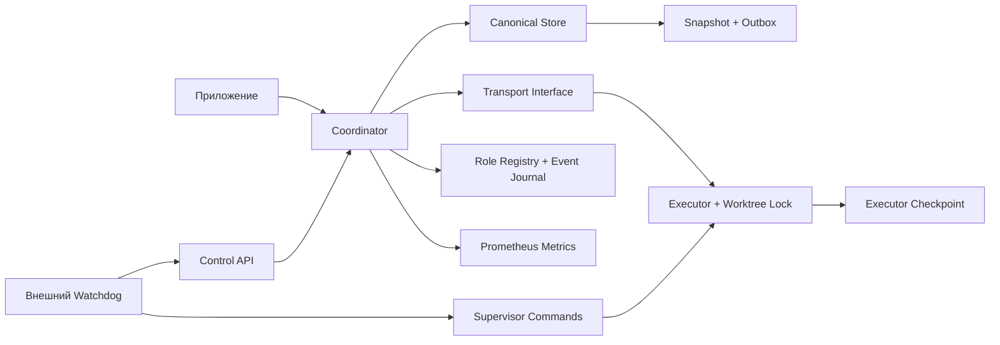
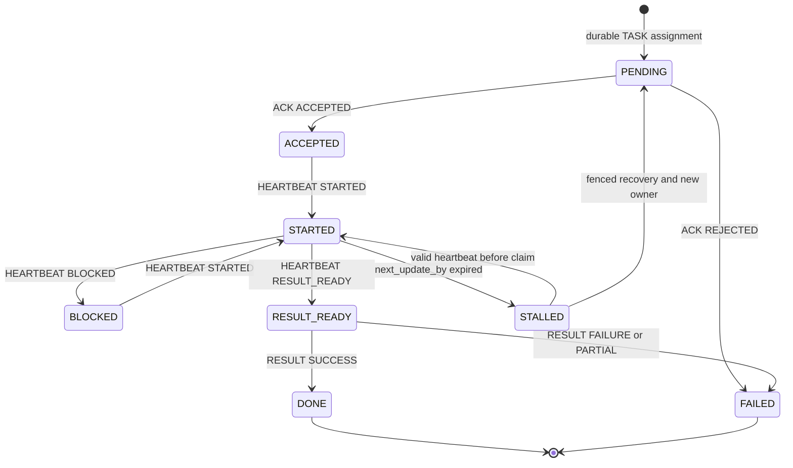

# Как устроено приложение

Этот документ описывает текущее устройство кода и явно разделяет:

- действующий legacy runtime;
- реализованный canonical core;
- ещё не подключённые production paths.

Целевое направление и статус компонентов приведены в
[TARGET-ARCHITECTURE.md](TARGET-ARCHITECTURE.md).

Нормы задают Accepted ADR и TASK-MODEL. Этот документ не создаёт новых норм.
При расхождении документа с принятым и покрытым тестами кодом документ
исправляется по R101.

`coord` разделяет подтверждение транспорта, подтверждение принятия задачи
и подтверждение результата. Сообщение доставлено — это ещё не задача принята.

Диаграмма ниже показывает компоненты, существующие в текущем репозитории, и
целевое направление владения. Она не означает, что все стрелки уже образуют
единый production path. Legacy CLI/localchat и standalone Telepathy paths
продолжают владеть отдельными runtime-файлами. Production mutations ещё не
полностью проходят через canonical daemon command path.

<!-- canonical-persistence -->
<!-- daemon-runtime -->
## Идентичность

В текущем wire/storage протоколе `Run.Task` и `Envelope.Task` — legacy task
label для корреляции исполнения; его исторические значения не гарантируют
идентичность будущей канонической Task и не преобразуются автоматически в
`TaskID` (см. [TASK-MODEL.md](TASK-MODEL.md) TM-03). `run` обозначает исполнение,
`attempt` — номер запуска, `target_sha` — базовый commit worktree. Повторная
доставка не изменяет эти поля. `owner_session` обозначает текущую сессию,
`fence` — поколение владения. Recovery сохраняет attempt, увеличивает fence и
меняет owner.

`agent_id` — доверенная стабильная identity, привязанная оператором к сессии.
Одно agent_id может иметь несколько session addresses. Проверка независимости
AUDITOR использует agent_id и историю владельцев, а не название модели или адрес.

`coordd` открывает versioned `canonical.json`, представляющий единый
`CanonicalState`. В текущую canonical schema входят: Tasks и Runs; Domain
Events; Inbox receipts и Outbox; AgentSession projections и append-only
AgentSessionEvents; типизированные ReviewResult и AuditResult; canonical
Discussion Graph. Startup валидирует schema version, внутренние инварианты и
связи между объектами. Изменение canonical состояния, Domain Event, Inbox
receipt и необходимого Outbox фиксируется одной durable mutation. Наличие
компонента в `CanonicalState` не означает, что для него уже подключён
production command path.

`coordd` также открывает `roles.json` (role registry). Процесс удерживает
`namespace.lock`, storage locks `canonical.json.lock` и `roles.json.lock` и
временный compatibility lock `runs.json.lock`. Legacy `runs.json` только
читается при startup: активный Run или неизвестная schema оставляет daemon в
diagnostic-only `NOT_READY`, импорта нет.

Основные canonical срезы P0-2 реализованы: Task aggregate и Task.Fence,
AgentSession projection/history/binding, authenticated canonical agent command
boundary (`CanonicalStore.ApplyAgentCommand`), ReviewResult и AuditResult,
canonical Discussion Graph core, atomic canonical persistence. Это не означает
закрытие границы этапа: production Task command path, операторские команды,
Shadow Validation, приёмка границы этапа и P0-3 production integration
остаются открытыми. `fsm.Run.TaskID` является отдельной связью и может быть
пустым только у переходного legacy Run; `Run.Task` не переинтерпретируется.

У проекта пока несколько отдельных runtime state owners. Локальный
`cmd/coord`/localchat пишет legacy `runs.json`, `rooms.json`, `connection.json`,
`answers/<run>.json`, `executors/<run>.json`, `events.jsonl`, `owner.key` и
credential-файлы `clients/<session>-<generation>.json`. Standalone
`cmd/coord-telepathy` host/worker пишет `runs.json`, `binding.json`,
`executor.json` и `task.json`; эти файлы принадлежат transport/executor
сценарию, а не canonical Task model. Rooms history export создаёт отдельную
Git-проекцию `.coord-history` и `history/projection.json`, а `daemon.log` —
append-only диагностический журнал локального CLI, не источник состояния. Demo,
examples, integration harness и тесты имеют собственные пути записи и не считаются
production runtime. Эти legacy и standalone процессы не входят в namespace lock
`coordd`; production mutations должны перейти на daemon command path в P0-3.

## Legacy Run execution lifecycle

Эта диаграмма описывает текущую FSM `fsm.Run`. Она не является канонической
Task Stage/Status моделью. Каноническая Task workflow использует отдельные оси
Stage и Status и описана в `TASK-MODEL.md` и `TARGET-ARCHITECTURE.md`.

Это схема типичного пути, а не исчерпывающий список переходов. Прямой RESULT
до RESULT_READY запрещён. Внутренний `ResumeStatus` позволяет восстановить
состояние до STALLED. Deadline может завершить любой нетерминальный run как FAILED.
Полную таблицу допустимых heartbeat переходов проверяет `fsm/fsm_test.go`.

<!-- canonical-agent-command-boundary -->
## Canonical agent command boundary

Каноническая граница `CanonicalStore.ApplyAgentCommand` реализована и проверена
тестами. Она проверяет: signed authenticated frame и локального получателя;
активную AgentSession; generation и текущий ключ; соответствие AgentID
назначению Run; Task, Run, Fence и Attempt; role и Stage; независимость ролей;
replay и ExpectedRevision; допустимость перехода. Для новой команды переход
Task/Run, Domain Event, Inbox receipt и Outbox фиксируются одной canonical
mutation.

Production caller path к `ApplyAgentCommand` ещё не подключён. Текущий реальный
вход продолжает использовать legacy `Coordinator.Handle`; production CLI и
Telepathy write paths остаются частью P0-3.

<!-- canonical-discussion-graph -->
## Canonical Discussion Graph

`CanonicalState` содержит принадлежащие Task типизированные Discussion nodes и
edges. Canonical validation проверяет: допустимые типы узлов и связей;
обязательные Actor и Role; принадлежность Task; ссылочную целостность;
ограничения специальных типов и связей; согласованность startup snapshot и
transition. Canonical core реализован. Production command path, read-only
projection, Owner Console и продуктовый Decision Resolver не реализованы.

<!-- canonical-review-audit-results -->
## Canonical Review и Audit results

Canonical model содержит типизированные `ReviewResult` и `AuditResult`. Приём
результата фиксирует одной durable mutation: typed result, переход Task,
terminal role Run, Domain Event, Inbox receipt, `RESULT_ACK` в Outbox. Startup
и transition validation проверяют принадлежность Task и Run, роль, Attempt,
допустимые verdict и references, независимость Reviewer и Auditor по стабильному
AgentID и истории Executor. Production agent/CLI caller path пока не подключён.

## Durable commit перед side effect

### Legacy Run path

В legacy Run path назначение и outbox сохраняются до отправки TASK. При
рестарте недоставленный Outbox повторяется. Executor устраняет повторное
выполнение по task/run/attempt/fence.

Store сериализует изменения, записывает snapshot и только после этого
публикует новую версию памяти. Входные slices/maps/pointers копируются, чтобы
вызывающий код и persistence не могли изменить опубликованное состояние.

### Canonical command model

В canonical command model переход Task/Run, Domain Event, Inbox receipt и
необходимый Outbox фиксируются одной `UpdateCanonical`. Новая версия памяти
публикуется только после успешного durable Save. При неопределённом durable
failure требуется повторное открытие состояния. Canonical transaction
реализована на store model, но production caller path к `ApplyAgentCommand` ещё
не подключён.

Файлы создаются с правами 0600; запись использует temp, fsync, atomic rename
и fsync родительской папки. На Linux, macOS, DragonFly BSD, FreeBSD, NetBSD,
OpenBSD и illumos kernel flock защищает canonical snapshot от второго
coordinator; на остальных платформах checkpoint storage отказывает закрытым
образом. Это single-owner хранилище, а не распределённая база.

## Legacy recovery и целевая Task-wide recovery

ACK и HEARTBEAT сообщают next_update_by. По истечении срока coordinator записывает
STALLED и запускает bounded retries. После исчерпания выставляет RecoveryNeeded.

Текущий watchdog реализует recovery legacy Run: durable claim, bounded retries,
остановка writer, проверка worktree, запуск replacement и передача legacy
ownership через CAS.

Canonical model содержит Task.Fence, Run.Fence snapshots и проверки AgentSession
binding. Но полная Task-wide передача writer ownership требует: supervisor stop
proof через daemon command path; durable привязку proof; повышение authoritative
Task.Fence; создание нового Run в одной canonical transaction. Этот
production-контур ещё не подключён.

Два процесса не должны писать в worktree одновременно. Отказ принять сообщение
и отправка ABORT не останавливают ОС-процесс; эту гарантию дают supervisor
и исключительный writer lock. При захваченном recovery claim прежние heartbeat
уже не изменяют canonical run.

Проверка поколения выполняется до проверки owner и deduplication: fence меньше
канонического отклоняется как stale, больше — как недопустимый future fence.
Допускается только точное совпадение fence и остальных полей identity. Счётчик
`uint64` не оборачивается при переполнении: recovery возвращает ErrFenceExhausted.

Fence не секретен. Старый процесс может узнать новое значение, но это не делает
его canonical owner. Проверка сообщений coordinator не запрещает запись в файлы
или внешнее API: ресурс должен сам проверять поколение, либо supervisor должен
подтвердить остановку writer до передачи владения. Очищать owner как замену
fencing нельзя. Lease deadline без правил renewal и контроля writer также
не даёт этой гарантии.

Метрики различают `coord_stale_fence_rejections_total`,
`coord_invalid_fence_rejections_total` и `coord_split_brain_events_total`.
Позднее сообщение старого поколения после recovery учитывается в stale counter,
а не как новый конфликт владельцев текущего поколения.

<!-- agent-session -->
## Динамические роли

Registry хранит revision, profiles, capabilities и audit events. ROLE_UPDATE
применяется атомарно с проверкой revision и повторного message_id; успех возвращает
ROLE_ACK. Каждое назначение сохраняет RoleSelection, а recovery — также RoleHistory.
Изменения registry влияют на следующие назначения, сохраняя профиль активного run.

Доверенный AgentID не берётся из имени модели, transport address, PID или поля
identity в теле команды. AgentID определяется через активную AgentSession,
текущее generation и проверенный ключ.

Transport signing подтверждает источник сообщения по pinned Ed25519 public key.
Registry registration и public-key provisioning остаются доверенными действиями
оператора. Transport signing, AgentSession registry и canonical agent command
boundary реализованы и проверены тестами. Production transport caller path к
`ApplyAgentCommand` ещё не подключён. Имена моделей и заявленные capabilities
остаются self-reported данными.

## Подтверждение результата

Canonical ReviewResult и AuditResult принимаются store model одной durable
transaction с Domain Event, Inbox receipt и `RESULT_ACK` в Outbox.

Executor RESULT production command path (#6) ещё не подключён. В legacy
executor path RESULT_READY, RESULT и local Outbox продолжают использовать
старую Run FSM.

В legacy path RESULT и RESULT_ACK записываются одной canonical transaction:
receipt коррелируется с message_id результата и содержит committed outcome.
Терминальный run повторяет недоставленный receipt; повтор RESULT получает новое
подтверждение без повторного выполнения. Executor хранит RESULT_READY и RESULT
в outbox до проверки receipt через Receipt, затем атомарно фиксирует DONE/FAILED
и очищает очередь. RESULT_ACK не разрешает coordinator закончить работу до
durable commit.

Ни durable result commit, ни `RESULT_ACK`, ни transport delivery не являются
stop proof ОС-процесса.

Heartbeat с timestamp старше последнего принятого heartbeat либо с меньшим
progress_pct отвергается без изменения run. Recovery очищает timestamp при новом
fence. Полный порядок при равных timestamps и clock skew требует sequence policy.

<!-- project-dependency-graph -->
<!-- startup-card-read-api -->
<!-- session-registry-supervisor -->
## Самостоятельный Telepathy host

`cmd/coord-telepathy` связывает coordinator/executor через отдельные MCP subprocess
и подписанный `coord/telepathy` byte Client. Host и worker имеют собственные
checkpoints и session/worktree locks. Это one-run deployment без canonical
Crewflow adapter и автоматического supervisor recovery. См. TELEPATHY_HOST.md.
