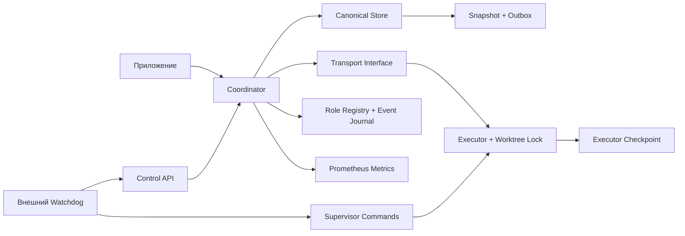
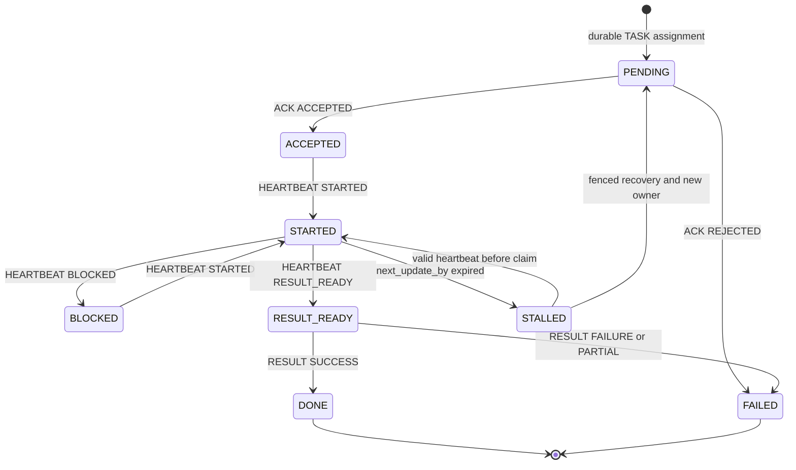

# Как устроено приложение

`coord` разделяет подтверждение транспорта, подтверждение принятия задачи
и подтверждение результата. Сообщение доставлено — это ещё не задача принята.

## Идентичность

`task` обозначает логическую задачу; `run` — её запуск; `attempt` — назначенную
попытку выполнения; `target_sha` — базовый commit worktree. Повторная доставка
не изменяет эти поля. `owner_session` обозначает текущую сессию, `fence` — поколение
владения. Recovery сохраняет attempt, увеличивает fence и меняет owner.

`agent_id` — доверенная стабильная identity, привязанная оператором к сессии.
Одно agent_id может иметь несколько session addresses. Проверка независимости
AUDITOR использует agent_id и историю владельцев, а не название модели или адрес.

## Рабочий цикл

Это схема типичного пути, а не исчерпывающий список переходов. Прямой RESULT
до RESULT_READY запрещён. Внутренний `ResumeStatus` позволяет восстановить
состояние до STALLED. Deadline может завершить любой нетерминальный run как FAILED.
Полную таблицу допустимых heartbeat переходов проверяет `fsm/fsm_test.go`.

## Commit перед side effect

Назначение и outbox сохраняются до отправки TASK. Store сериализует изменения,
записывает snapshot и только после этого публикует новую версию памяти.
Если snapshot не записался, TASK не отправляется. При рестарте outbox повторяется.
Executor устраняет повторное выполнение по task/run/attempt/fence.

Файлы создаются с правами 0600; запись использует temp, fsync, atomic rename
и fsync родительской папки. Unix flock защищает canonical snapshot от второго
coordinator. Это single-owner хранилище, а не распределённая база.

## Таймауты и recovery

ACK и HEARTBEAT сообщают next_update_by. По истечении срока coordinator записывает
STALLED и запускает bounded retries. После исчерпания выставляет RecoveryNeeded.
Watchdog сначала получает durable claim, затем останавливает writer, проверяет
worktree, запускает replacement и передаёт владение через CAS.

Два процесса не должны писать в worktree одновременно. Отказ принять сообщение
и отправка ABORT не останавливают ОС-процесс; эту гарантию дают supervisor
и исключительный writer lock. При захваченном recovery claim прежние heartbeat
уже не изменяют canonical run.

## Динамические роли

Registry хранит revision, profiles, capabilities и audit events. ROLE_UPDATE
применяется атомарно с проверкой revision и повторного message_id; успех возвращает
ROLE_ACK. Каждое назначение сохраняет RoleSelection, а recovery — также RoleHistory.
Изменения registry влияют на следующие назначения, сохраняя профиль активного run.

Transport signing подтверждает источник сообщения по pinned Ed25519 public key.
Registry registration и public-key provisioning остаются доверенными действиями
оператора. Имена моделей и capabilities остаются self-reported.
