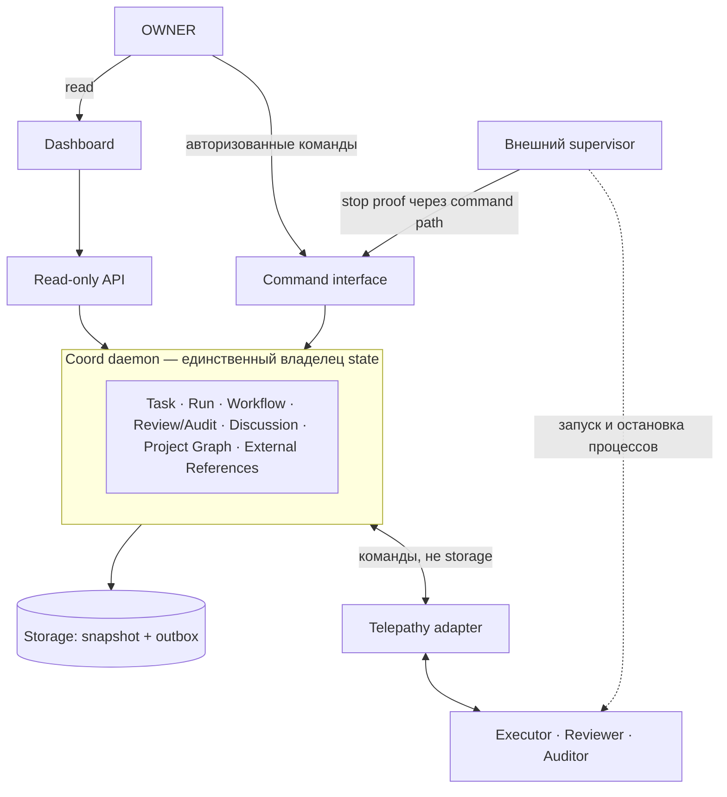
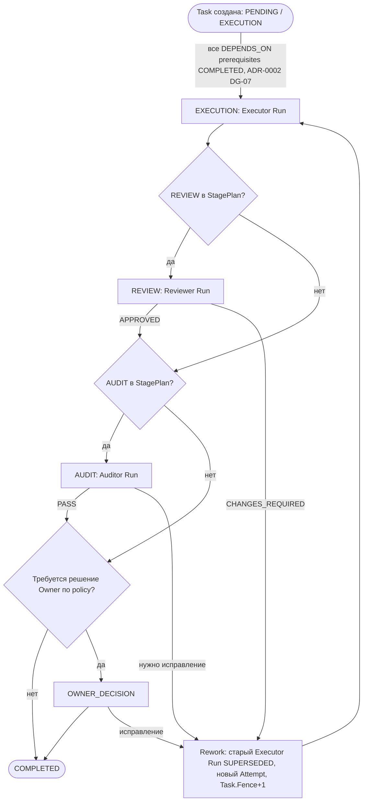
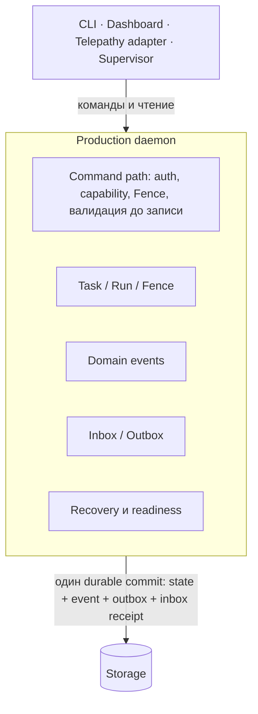

# Целевая архитектура Coord

Карта для сверки: куда ведут принятые ADR и что из этого уже есть в коде.
Нормы задают ADR-0001…ADR-0005 и TASK-MODEL; этот документ их не заменяет и
новых правил не вводит. При расхождении прав ADR, а карту нужно исправить.
Текущее устройство кода описано в [ARCHITECTURE.md](ARCHITECTURE.md).

Статусы компонентов: **есть** — реализовано и проверено тестами; **частично** —
есть основа, гарантия ADR не закрыта; **нет** — только в ADR.

| Компонент | Статус | Норма |
|---|---|---|
| Run FSM, Run.Fence, outbox, recovery через watchdog | есть | ARCHITECTURE.md |
| Run-only storage слой | есть, отдельный слой: `store.Persistence` сериализует только `map[RunID]Run` (`store/store.go:18-21`), `checkpoint.File` пишет versioned JSON snapshot через temp file, file sync, rename и directory sync, `store.Update` публикует память после успешного `Save` и требует reopen после неопределённого durable failure (`store/store.go:106-133`) | ADR-0005 |
| Fail-closed exclusive lock snapshot | есть: на Linux, macOS, DragonFly BSD, FreeBSD, NetBSD, OpenBSD и illumos snapshot lock использует kernel `flock`; на остальных платформах checkpoint storage обязан завершаться `ErrUnavailable`, а не продолжать без process ownership | ADR-0005 ST-02 |
| Канонический persistence | частично: `store.CanonicalPersistence` принимает и возвращает полную `CanonicalState` — Tasks, Runs, Events, Inbox, Outbox, AgentSessions и AgentSessionEvents — как один durable unit (интерфейс `store.CanonicalPersistence` в `store/canonical.go`); `checkpoint.CanonicalFile` читает и пишет этот документ через тот же atomic file replacement — temp file, fsync, rename, sync каталога (`internal/atomicfile/atomicfile.go:14-52`) — с проверкой schema version и инвариантов до и после записи (`checkpoint/canonical.go:25-63`, `:65-74`). Production composition `coordd` открывает именно его: `store.NewCanonical(checkpoint.CanonicalFile{Path: canonical.json})` (`cmd/coordd/main.go:107`), а активный legacy Run оставляет процесс в diagnostic-only `NOT_READY` (`cmd/coordd/main.go:145-149`). Discussion, Project Relations и внешний API поверх этого состояния не реализованы; Review/Audit Results и durable Inbox/Outbox уже входят в тот же канонический transaction unit | ADR-0005 |
| Telepathy 0.8.0 MCP transport, one-run host/worker | есть (не подключён к daemon) | ROADMAP; TELEPATHY_HOST.md |
| TaskID adoption | есть: `taskid.New` (`taskid/id.go:34`) и тип `taskid.ID` (`taskid/id.go:31`) используются `task.Task`, `fsm.Run` и каноническим store; выдача ID проверена `TestCreateTaskGeneratesCanonicalTaskID` (`internal/taskservice/service_test.go:33`) | ADR-0001 шаг 2; ADR-0003 |
| Library daemon host (listeners, readiness по Run) | частично: `/readyz` реализует только operational readiness существующего Run coordinator — успешный startup `Tick`, инициализированный transport receive, отсутствие `Run.RecoveryNeeded`; lock и валидация Run snapshot выполняются до передачи Coordinator в host (`store.New`, `coord.New`). Task-wide fence, конфликтующие writer Runs, канонические Task схемы и полный RT-03 recovery не реализованы, поэтому `/readyz` не критерий их готовности и не закрывает P0 Production coordinator daemon. Текущие причины not-ready: `transport_receive_not_initialized`, `supervisor_recovery_pending`; дополнительные появятся вместе с реализацией проверок | ADR-0004 RT-03 |
| Standalone daemon `cmd/coordd`, namespace lock, process-kill acceptance | частично: P0-1 в работе, приёмка не закрыта. `coordd` открывает канонический store (`store.NewCanonical` + `checkpoint.CanonicalFile`, `cmd/coordd/main.go:107`) и валидирует схему и инварианты до готовности, поэтому он не Run-only; канонический state при этом только читается и валидируется — production agent/CLI write path ещё не подключён (P0-3). Порядок владения проверяется до открытия store: `TestCoorddTakesNamespaceLockBeforeStores` (`cmd/coordd/main_test.go:157`) | ADR-0004 RT-01, RT-03; docs/plans/p0-daemon/DESIGN.md |
| Единый command path для всех writer | нет: localchat host пишет runs.json напрямую | ADR-0004 RT-04 |
| Task aggregate, `task_<ULID>`, Task.Fence | частично: канонический Task aggregate со связью Task ↔ Run, `Task.Fence` и историей DomainEvent в одном типе `CanonicalState` (`store/canonical.go`); storage transition и startup проверяют Fence snapshot chain, transfer marker и связь Run.Fence (R75a/R75b); supervisor stop proof и production command path остаются открытыми. Проверки: `TestCanonicalStateValidatesTaskEventAndRunRelations`, `TestCanonicalStoreRejectsTaskMutationWithoutEvent` | TASK-MODEL; ADR-0003; ADR-0004 RT-06 |
| Production CLI/agent write path → daemon → Task | нет (P0-3) | ADR-0004 RT-04; ADR-0001 шаг 11 |
| AgentSession (CM-13, TM-27) | частично: проекция `agentsession.Session` (адрес, `AgentID`, поколение, публичный ключ, время регистрации и отзыва) и append-only история `agentsession.Event` в типе `CanonicalState` schema v1, поля `AgentSessions` и `AgentSessionEvents` (`store/canonical.go`); нормализация пустых коллекций в `NormalizeCanonicalState` (`store/canonical.go`); история проверяется при startup — `agentsession.ValidateHistory` в `ValidateCanonicalState` — и на переходе — `agentsession.ValidateTransition` в `ValidateCanonicalTransition` (`store/canonical.go`); правила проверки в `agentsession/session.go:28-54` (модель), `:61` (история), `:141` (переход). Часть 2: store-level операции `RegisterAgentSession`, `RotateAgentSessionKey` и `ReplaceAgentSessionAddress` (`store/canonical_agentsession.go`), каждая — одна durable запись через `UpdateCanonical`; `NewCanonicalWithClock` (`store/canonical.go`) задаёт источник времени, nil-clock отклоняется. Часть 3: `fsm.Run.AgentSessionGeneration` входит в `SameDomainState` (`fsm/fsm.go`), привязка Task-scoped Run проверяется на хранении в `validateCanonicalAgentSessionBindings` и `validateRunAgentSessionBinding`, назначение и recovery transfer — в `validateCanonicalAgentSessionAssignments` (`store/canonical_agentsession_binding.go`), вызовы из `ValidateCanonicalState` и `ValidateCanonicalTransition` (`store/canonical.go`): при назначении требуется текущая активная привязка, текущее поколение и совпадение `AgentID`; recovery transfer идёт только на текущую активную привязку; `AgentID` не меняется в том же `OwnerSession`; при startup отвергаются generation выше привязки, отсутствующая привязка и чужой `AgentID`, а stale или отозванная привязка допускается (OWNER [#13](https://github.com/naghuale/coord/issues/13), вариант A). R123: активный, то есть нетерминальный, включая `STALLED`, Task-scoped Run без generation оставляет `coordd` в diagnostic-only режиме с `/readyz` 503 и без переписи файла; Run без `TaskID` не затрагиваются. Проверки части 1 (все 12 в `agentsession/session_test.go`): `TestValidateHistoryRebuildsRegisteredRotatedAndRevokedSession`, `TestValidateHistoryRejectsProjectionThatDisagreesWithEvents`, `TestValidateHistoryRejectsProjectionWithDifferentPublicKey`, `TestValidateHistoryRejectsEventsWithoutCurrentProjection`, `TestValidateHistoryRejectsSkippedGeneration`, `TestValidateHistoryRejectsRevocationWithWrongGeneration`, `TestValidateHistoryRejectsRotationWithoutChangingPublicKey`, `TestValidateHistoryRejectsEventTimeBeforePriorAddressEvent`, `TestValidateHistoryRejectsEventsAfterRevocation`, `TestValidateHistoryAllowsOneAgentAcrossMultipleAddresses`, `TestValidateTransitionAcceptsRevocationAndRejectsProjectionChangeWithoutEvent`, `TestValidateTransitionRejectsRewrittenOrDeletedHistory`; в store — `TestCanonicalValidationChecksAgentSessionHistory` (`store/canonical_test.go:27`); совместимость старого schema v1 — `TestCanonicalFileReadsAndRewritesCreationOnlyV1WithoutFenceField` (`checkpoint/canonical_test.go:266`). Проверки части 2 (все 7 в `store/canonical_agentsession_test.go`): `TestCanonicalAgentSessionRegistrationPersistsOperatorBinding`, `TestCanonicalAgentSessionKeyRotationIncrementsGenerationAtomically`, `TestCanonicalAgentSessionRotationRejectsRevokedBindingWithoutWrite`, `TestCanonicalAgentSessionAddressChangeRevokesAndRegistersInOneCommit`, `TestCanonicalAgentSessionAddressChangeFailureDoesNotPartiallyRevoke`, `TestCanonicalAgentSessionAddressChangeRejectsInactiveOrExistingAddressWithoutWrite`, `TestNewCanonicalWithClockRejectsNilClock`. Проверки части 3 (все 11: 10 в `store/canonical_agentsession_binding_test.go`, 1 в `cmd/coordd/main_test.go`): `TestCanonicalStartupRequiresGenerationAndBindingForActiveTaskRun`, `TestCanonicalStartupAllowsStaleGenerationAndRevokedExistingBinding`, `TestCanonicalStartupRejectsForgedRunGenerationAndAgentID`, `TestLegacyRunDoesNotRequireAgentSessionGeneration`, `TestCanonicalAssignmentTakesCurrentActiveAgentSessionBinding`, `TestCanonicalRunGenerationCannotChangeWithoutRecoveryTransfer`, `TestCanonicalRecoveryTransferChangesAgentWithOwnerAndHistory`, `TestCanonicalRecoveryTransferRequiresCurrentActiveAgentSession`, `TestCanonicalRecoveryTransferCannotChangeAgentWithoutRoleHistoryAppend`, `TestFSMRunDomainStateIncludesAgentSessionGeneration`, `TestCoorddReadinessFailsClosedForActiveTaskRunWithoutAgentSessionBinding`. Не реализовано: подключение регистрации и ротации к операторскому command path и OwnerCredential, отдельная операция отзыва без новой привязки, Часть 4: `transport.AuthenticatedFrame` с приватными полями и проверкой подписи и локального получателя (`transport/signed.go`), резолвер ключа и поколения из реестра `AgentSession` без fallback на legacy `Peers` (`SignedClient.IncomingAuthenticated`, `AuthenticatedAdapter.ReceiveAuthenticated`) (`TestSignedClientIncomingAuthenticatedCarriesResolvedSessionEvidence`, `TestSignedClientResolverErrorDoesNotFallbackToPeers`, `TestSignedClientRejectsZeroResolvedGeneration`, `TestAgentCommandLegacyPeersDoNotAuthorizeAgentCommand`, `TestSignedClientAuthenticatedFrameCopiesReceivedSignedBytes`, `TestAuthenticatedAdapterRejectsWrongRecipient`); каноническая граница `CanonicalStore.ApplyAgentCommand` (`store/canonical_agent_command.go`) повторно проверяет подпись на границе store до блокировки, а текущую привязку, поколение и совпадение ключа, а также проверки состояния выполняет под `s.mu`; затем Run, Fence, Attempt, роль и Stage, а независимость роли проверяется до replay lookup без durable Save (`TestAgentCommandRejectsRoleIdentityCollisionBeforeReplay`, `TestAgentCommandRoleIdentityCollisionRejectsPriorReceiptBeforeReplay`, [#26](https://github.com/naghuale/coord/issues/26)); и только для новой команды выполняет CAS по `Task.Revision` и один commit с переходом, событием, receipt и подтверждением в Outbox (`TestAgentCommandCommitsEventReceiptOutboxAtomically`, `TestAgentCommandRejectsInvalidFrameBeforePersistence`, `TestAgentCommandRejectsFabricatedAuthenticatedFrame`, `TestAgentCommandRejectsEnvelopeDifferentFromSignedBytes`, `TestAgentCommandCopiesSignedBytesBeforeReadingOtherFrameFields`, `TestAgentCommandRevokedSessionDoesNotReturnPriorReceipt`, `TestAgentCommandRejectsOldSessionBeforeFenceCheckBypassedByKnownMessageID`, `TestAgentCommandRejectsStaleGenerationBeforeReplay`, `TestAgentCommandRejectsSignedFrameFromDifferentKeyAtCurrentGeneration`, `TestAgentCommandRejectsSessionAgentIDMismatchBeforeReplay`, `TestAgentCommandRejectsNonCurrentWriter`, `TestAgentCommandRejectsStaleFence`, `TestAgentCommandRejectsFutureFence`, `TestAgentCommandRejectsAttemptMismatch`, `TestAgentCommandRejectsMissingAgentIDForEveryRole`, `TestAgentCommandRejectsRoleStageMismatch`, `TestAgentCommandRoleStageMappingRejectsWrongRoleAndStage`, `TestAgentCommandRejectsRoleIdentityCollisionBeforeReplay`, `TestAgentCommandAppliesRoleIndependenceFromCommittedRun`, `TestAgentCommandReplayReturnsPriorReceiptWithoutWriting`, `TestAgentCommandReplayWithDifferentExpectedRevisionRefused`, `TestAgentCommandReplayAfterRevisionGrowthReturnsPriorReceipt`, `TestAgentCommandRejectsStaleRevision`, `TestAgentCommandRejectsForbiddenTransition`, `TestAgentCommandRejectsInboxWithoutCommittedAcknowledgement`, `TestAgentCommandBoundaryResolvesActorInsideLock`, `TestAgentCommandIgnoresActorIDFromBody`, `TestAgentCommandValidSignatureWithoutRunOwnershipIsRefused`, `TestAgentCommandTransportDeliveryIsNotAcceptance`); actor берётся из проверенного назначения Run, а не из тела команды. Не реализовано: production command path не подключён — `ApplyAgentCommand` вызывается только из тестов, реальный вход остаётся legacy `Coordinator.Handle` (`coordinator.go`); `OwnerCredential` не реализован; команд управления `AgentSession` в границе нет (store-level операции `RegisterAgentSession`, `RotateAgentSessionKey`, `ReplaceAgentSessionAddress` агентскими командами не являются); Executor RESULT (#6) не подключён — P0-3. Обязательный непустой `AgentID` (R116, CM-14, TM-28) требуется при назначении Task-scoped Run (`validateRunAgentSessionBinding`; `TestCanonicalAssignmentTakesCurrentActiveAgentSessionBinding`) и на входящей агентской команде для всех ролей (`TestAgentCommandRejectsMissingAgentIDForEveryRole`); отдельного теста на пустой `AgentID` при каноническом назначении нет. Отозванный адрес не регистрируется повторно никогда, вернувшийся агент регистрируется на новом адресе с прежним `AgentID` (R126: повторная регистрация с поколения 1 совпала бы с огороженным Run по R125 и сняла бы ограждение, то есть вернула бы ABA): `RegisterAgentSession` и `ReplaceAgentSessionAddress` отклоняют адрес, бывший в истории (`ErrAgentSessionAddressExists`), а `agentsession.ValidateHistory` запрещает события после отзыва | ADR-0001 CM-13; TASK-MODEL TM-27 |
| ReviewResult, AuditResult | частично. RA-1 (`a32acc6`): типизированные `ReviewResult`/`AuditResult` в DomainEvent schema v1 (`task/result.go:53`, `:62`; типы событий `task/event.go:15-16`), приёмка результата одним commit — typed result, переход Task в `BLOCKED` на том же Stage, терминальный role Run, DomainEvent, Inbox receipt, `RESULT_ACK` (`store/canonical_result.go:17`, `:26`, `:70-158`; `TestReviewResultCommitsWithTransitionEvent`, `TestAuditResultCommitsWithTransitionEvent`), startup validation payload, связей Task/Run/role/Attempt и ссылок (`store/canonical_result.go:199-280`; `TestReviewAuditResultStartupValidationRejectsInvalidAssociations`), координаторские ID и время findings, закрытые множества verdict, refs только `TASK`/`RUN`/`DOMAIN_EVENT` (`:321-322`, `ARTIFACT` — fail closed; `TestReviewResultRejectsInvalidAndOutOfScopeReferences`). RA-2 (`2d0cf60`): независимость Reviewer/Auditor по стабильному `AgentID` против истории Executor проверяется при startup и на переходе до durable Save (`store/canonical_independence.go:29`, вызовы `validateCanonicalRoleIndependence` в `ValidateCanonicalState` и `ValidateCanonicalTransition` (`store/canonical.go`); `TestReviewerRejectsExecutorAgentIDAcrossHistory`, `TestAuditorRejectsExecutorAgentIDAcrossTaskRuns`). RA-3 (R133): бывший Reviewer/Auditor → Executor той же Task отклоняется в канонической валидации (`TestFormerReviewerOrAuditorCannotLaterBecomeExecutor`). Не реализовано: production agent/CLI command path и command boundary (P0-3), supervisor stop proof и поле причины блокировки `WAITING_FOR_SUPERVISOR_STOP`, stage scheduler и переход в следующий Stage, Discussion Graph, canonical Artifact metadata (refs пустые), read-only API и Startup Card (ADR-0006) | ADR-0001 шаг 8 |
| Discussion Graph | нет | ADR-0001 «Discussion Graph» |
| Project Dependency Graph | нет | ADR-0002 |
| External References | нет | ADR-0003 |
| Startup Card, read-only API, Dashboard | нет: read-only API Task не написан, ни один endpoint не отдаёт проекцию Task. Внешний control interface у daemon есть (bearer-token handler, `control.go:20-36`), но его `GET /runs` возвращает только stalled-результаты для supervisor recovery — это не `RunViewStatus` и не проекция Task | ADR-0001; ADR-0006 (не написан) |
| Project/Task Brief | Proposed: MVP остаётся контрактом, а не функцией; данных Task и Run уже достаточно, отсутствует read-only API для Task. Проекция сессии в `internal/rooms` — legacy и опорой Brief не служит | ADR-0007 |
| Автономная приёмка и git commit | Proposed; до пересмотра — локальный commit координатором по AGENTS.md «Commit Readiness» (R127) | ADR-0008 |

## Номера ADR

Статус Accepted или Proposed берётся из шапки самого ADR. Здесь перечислены
только номера, файла для которых ещё нет, чтобы их не заняли повторно.

| Номер | Назначение | Где зарезервирован |
|---|---|---|
| ADR-0006 | API Contract: read-only API и Startup Card | ADR-0001 «Порядок реализации», шаг 12; ADR-0004 RT-05 |

Новый ADR получает следующий свободный номер после последнего файла или
зарезервированного номера.

## 1. Система целиком



- Dashboard и API только читают; решения Owner идут через отдельный
  авторизованный command interface (ADR-0004 RT-05).
- Доставка через Telepathy не означает принятия задачи или результата.
- Daemon не запускает процессы; это делает внешний supervisor, который не
  управляет workflow (ADR-0004 «Process Ownership»).

## 2. Task: каноническая модель

```text
Task
├── TaskID           task_<ULID> (ADR-0003)
├── StagePlan        валидирован, с PolicyVersion
├── CurrentStage     EXECUTION | REVIEW | AUDIT | OWNER_DECISION; у терминальной Task нет
├── Status           PENDING | IN_PROGRESS | BLOCKED | FAILED | COMPLETED  (ось, отдельная от Stage)
├── Task.Fence       авторитетная эпоха записи (ADR-0004 RT-06)
├── Runs             у каждого Run.Fence — снимок эпохи, не авторитет
├── ReviewResult, AuditResult
├── Discussion       типизированные узлы и связи
├── Artifacts
└── External References
```

`COMPLETED` — это Status, а не Stage. `NEEDS_OWNER_DECISION` — это
`CurrentStage=OWNER_DECISION` при `Status=BLOCKED` (TASK-MODEL).

## 3. Workflow задачи



- `REWORK_REQUIRED` — результат Review/Audit, а не Stage и не Status.
- Между стадиями Task ждёт stop proof прежнего writer:
  `BLOCKED / тот же Stage` с причиной `WAITING_FOR_SUPERVISOR_STOP`.
- Rework при невыполненном prerequisite даёт `BLOCKED / EXECUTION` без нового
  Run (ADR-0002 DG-07).
- Полная таблица переходов — TASK-MODEL «Stage transitions».

## 4. Ownership и Fence

```mermaid
sequenceDiagram
    participant W as Текущий writer Run (Task.Fence = N)
    participant D as Daemon
    participant S as Supervisor
    participant X as Следующий writer
    W->>D: RESULT (проверка TaskID, RunID, Attempt, generation, Fence = N)
    D->>D: durable commit результата; RESULT_ACK уходит через outbox
    Note over D: ни RESULT commit, ни RESULT_ACK не доказывают остановку процесса
    D-->>S: запрос остановки старого writer
    S->>D: stop proof через command path
    D->>D: проверка привязки proof, durable receipt
    D->>X: в одной транзакции: Task.Fence = N+1, новый Run, событие, outbox
```

Инвариант: на Task не больше одного активного writer Run (ADR-0004 RT-06).
Без stop proof новый writer не назначается. Записи со старым Fence
отклоняются.

## 5. Discussion Graph

Это граф, а не цепочка и не отдельная FSM (ADR-0001 «Discussion Graph»).

- Узлы: `QUESTION`, `PROPOSAL`, `FACT`, `FINDING`, `DECISION`, `ACTION`,
  `RESULT`, `BLOCKER`.
- Связи: `ANSWERS`, `SUPPORTS`, `CAUSED_BY`, `RESULT_OF`, `BLOCKS`,
  `REFERS_TO`.

Пример одной Task:

```text
FINDING «вторая FSM в rooms» ──CAUSED_BY──► FACT «rooms и runs хранят разное состояние»
DECISION «Room — проекция Task» ──SUPPORTS──► FINDING
ACTION «написать ADR-0001» ──RESULT_OF──► DECISION
RESULT «ADR-0001 принят» ──RESULT_OF──► ACTION
```

Узлы и связи принадлежат Task и записываются доменными событиями; вторая
авторитетная копия графа не ведётся.

## 6. Project Dependency Graph

```text
TASK:task_<ULID-B> ──DEPENDS_ON──► TASK:task_<ULID-A>
```

- Идентификаторы TASK-узлов — только `task_<ULID>`. Номера issue и тикетов
  отклоняются (ADR-0002 DG-01).
- `BLOCKS` — вычисляемая обратная проекция, она не хранится.
- Узлы ADR и MILESTONE закрыты fail-closed, пока нет доверенного каталога. MVP —
  только TASK.
- Менять граф может только Owner с ожидаемой Graph Revision (ADR-0002 DG-06a,
  DG-08).

## 7. Startup Card

Coord строит карточку из одного согласованного снимка Task, Stage, Run и
Session:

- роль, session, generation;
- Task, Stage, Run, Attempt, Fence;
- цель, входы, ожидаемый структурированный результат;
- разрешённые и запрещённые операции, критерии завершения;
- активные blockers, следующий участник;
- revision карточки.

Карточка не даёт полномочий и не содержит секретов. Права проверяются по session
capability, роли и текущему Fence. Агент получает ссылку только на Brief своей
Task (ADR-0007).

## 8. Runtime после P0



- Telepathy работает как клиент command path, а не как слой под storage.
- Readiness проходит шаги ADR-0004 RT-03. Durable commit состояния описан в
  ADR-0005 ST-01 и ST-03; это не git commit из ADR-0008.

## 9. Порядок P0

P0-1 daemon runtime skeleton (ADR-0001 шаг 6) → P0-2 Task aggregate +
Task.Fence + транзакция state/event/outbox (шаг 7) → Review/Audit и Discussion
Graph (шаги 8–9) → Shadow Validation (шаг 10) → P0-3 production CLI и
Telepathy write paths → daemon → Task (RT-04; шаг 11) → P0-4 executor lifecycle
→ P0-5 supervisor. TaskID adoption
входит в P0-2. Источник — docs/ROADMAP.md.

## Как сверяться агенту

1. Найдите компонент в таблице статусов. Если статус «нет», не предполагайте,
   что он есть в коде.
2. Правила берите из ADR по идентификатору (RT-xx, ST-xx, DG-xx, EXT-xx, TID-xx,
   BR-xx, AC-xx). Эта карта только ссылается на них.
3. Новые пути записи идут только через daemon. Обход — нарушение ADR-0004 RT-04,
   даже если «временно».
