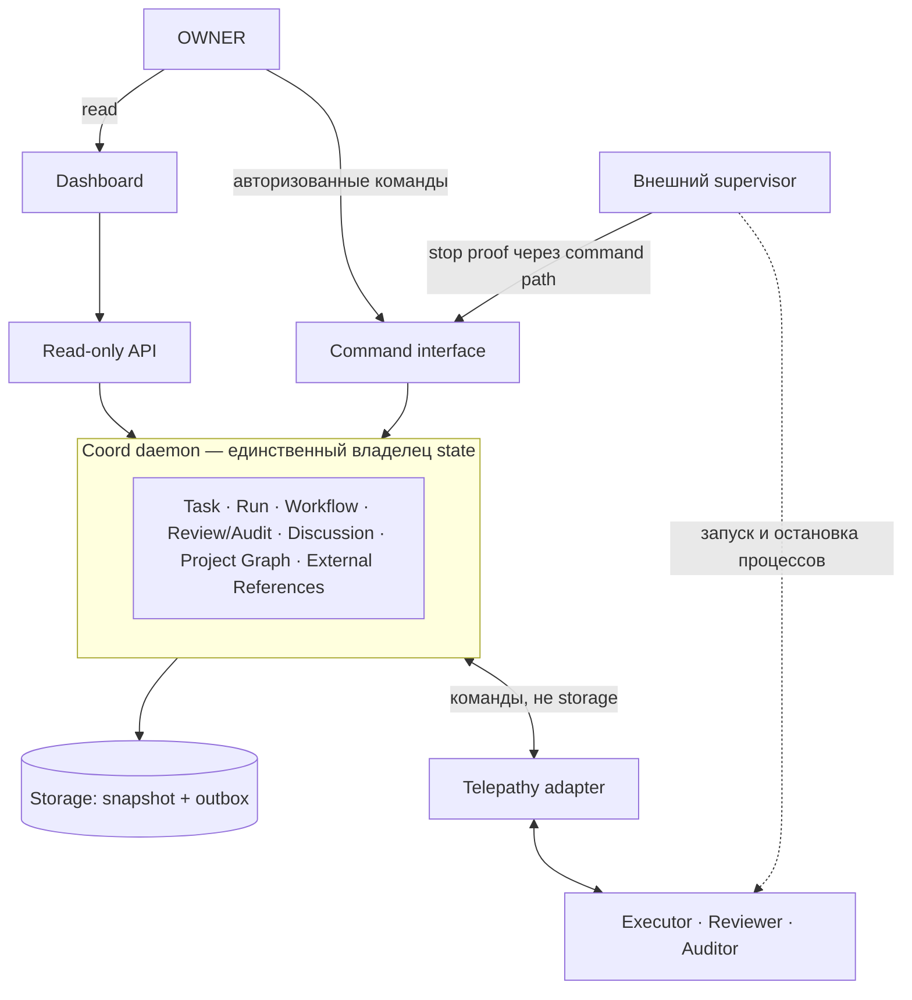
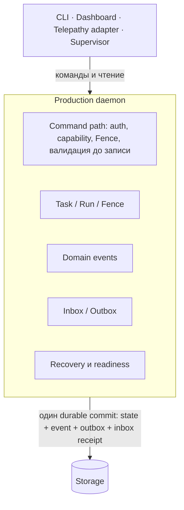

# Целевая архитектура Coord

Карта для сверки: куда ведут принятые ADR и что из этого уже есть в коде.
Нормы задают ADR-0001…ADR-0005 и TASK-MODEL; этот документ их не заменяет и
новых правил не вводит. При расхождении прав ADR, а карту нужно исправить.
Текущее устройство кода описано в [ARCHITECTURE.md](ARCHITECTURE.md).

Статусы компонентов: **есть** — реализовано и проверено тестами; **частично** —
есть основа, гарантия ADR не закрыта; **нет** — только в ADR.

| Компонент | Статус | Норма |
|---|---|---|
| Run FSM, Run.Fence, outbox, recovery через watchdog | есть | ARCHITECTURE.md |
| Fail-closed exclusive lock snapshot | есть | ADR-0005 ST-02 |
| Telepathy 0.8.0 MCP transport, one-run host/worker | есть (не подключён к daemon) | ROADMAP; TELEPATHY_HOST.md |
| Library daemon host (listeners, readiness по Run) | частично | ADR-0004 RT-03 |
| Standalone daemon `cmd/coordd` (Run-only), namespace lock, process-kill acceptance | частично: P0-1 в работе, приёмка не закрыта | ADR-0004 RT-01, RT-03; docs/plans/p0-daemon/DESIGN.md |
| Единый command path для всех writer | нет: localchat host пишет runs.json напрямую | ADR-0004 RT-04 |
| Task aggregate, `task_<ULID>`, Task.Fence | частично: storage transition и startup проверяют Fence snapshot chain, transfer marker и связь Run.Fence (R75a/R75b); supervisor stop proof и production command path остаются открытыми | TASK-MODEL; ADR-0003; ADR-0004 RT-06 |
| Production CLI/agent write path → daemon → Task | нет (P0-3) | ADR-0004 RT-04; ADR-0001 шаг 11 |
| ReviewResult, AuditResult | нет | ADR-0001 шаг 8 |
| Discussion Graph | нет | ADR-0001 «Discussion Graph» |
| Project Dependency Graph | нет | ADR-0002 |
| External References | нет | ADR-0003 |
| Startup Card, read-only API, Dashboard | нет | ADR-0001; ADR-0006 (не написан) |
| Project/Task Brief | Proposed | ADR-0007 |
| Автономная приёмка и git commit | Proposed; до пересмотра — ручной commit по AGENTS.md «Commit Readiness» | ADR-0008 |

## Номера ADR

Статус Accepted или Proposed берётся из шапки самого ADR. Здесь перечислены
только номера, файла для которых ещё нет, чтобы их не заняли повторно.

| Номер | Назначение | Где зарезервирован |
|---|---|---|
| ADR-0006 | API Contract: read-only API и Startup Card | ADR-0001 «Порядок реализации», шаг 12; ADR-0004 RT-05 |

Новый ADR получает следующий свободный номер после последнего файла или
зарезервированного номера.

## 1. Система целиком



- Dashboard и API только читают; решения Owner идут через отдельный
  авторизованный command interface (ADR-0004 RT-05).
- Доставка через Telepathy не означает принятия задачи или результата.
- Daemon не запускает процессы; это делает внешний supervisor, который не
  управляет workflow (ADR-0004 «Process Ownership»).

## 2. Task: каноническая модель

```text
Task
├── TaskID           task_<ULID> (ADR-0003)
├── StagePlan        валидирован, с PolicyVersion
├── CurrentStage     EXECUTION | REVIEW | AUDIT | OWNER_DECISION; у терминальной Task нет
├── Status           PENDING | IN_PROGRESS | BLOCKED | FAILED | COMPLETED  (ось, отдельная от Stage)
├── Task.Fence       авторитетная эпоха записи (ADR-0004 RT-06)
├── Runs             у каждого Run.Fence — снимок эпохи, не авторитет
├── ReviewResult, AuditResult
├── Discussion       типизированные узлы и связи
├── Artifacts
└── External References
```

`COMPLETED` — это Status, а не Stage. `NEEDS_OWNER_DECISION` — это
`CurrentStage=OWNER_DECISION` при `Status=BLOCKED` (TASK-MODEL).

## 3. Workflow задачи


- `REWORK_REQUIRED` — результат Review/Audit, а не Stage и не Status.
- Между стадиями Task ждёт stop proof прежнего writer:
  `BLOCKED / тот же Stage` с причиной `WAITING_FOR_SUPERVISOR_STOP`.
- Rework при невыполненном prerequisite даёт `BLOCKED / EXECUTION` без нового
  Run (ADR-0002 DG-07).
- Полная таблица переходов — TASK-MODEL «Stage transitions».

## 4. Ownership и Fence

```mermaid
sequenceDiagram
    participant W as Текущий writer Run (Task.Fence = N)
    participant D as Daemon
    participant S as Supervisor
    participant X as Следующий writer
    W->>D: RESULT (проверка TaskID, RunID, Attempt, generation, Fence = N)
    D->>D: durable commit результата; RESULT_ACK уходит через outbox
    Note over D: ни RESULT commit, ни RESULT_ACK не доказывают остановку процесса
    D-->>S: запрос остановки старого writer
    S->>D: stop proof через command path
    D->>D: проверка привязки proof, durable receipt
    D->>X: в одной транзакции: Task.Fence = N+1, новый Run, событие, outbox
```

Инвариант: на Task не больше одного активного writer Run (ADR-0004 RT-06).
Без stop proof новый writer не назначается. Записи со старым Fence
отклоняются.

## 5. Discussion Graph

Это граф, а не цепочка и не отдельная FSM (ADR-0001 «Discussion Graph»).

- Узлы: `QUESTION`, `PROPOSAL`, `FACT`, `FINDING`, `DECISION`, `ACTION`,
  `RESULT`, `BLOCKER`.
- Связи: `ANSWERS`, `SUPPORTS`, `CAUSED_BY`, `RESULT_OF`, `BLOCKS`,
  `REFERS_TO`.

Пример одной Task:

```text
FINDING «вторая FSM в rooms» ──CAUSED_BY──► FACT «rooms и runs хранят разное состояние»
DECISION «Room — проекция Task» ──SUPPORTS──► FINDING
ACTION «написать ADR-0001» ──RESULT_OF──► DECISION
RESULT «ADR-0001 принят» ──RESULT_OF──► ACTION
```

Узлы и связи принадлежат Task и записываются доменными событиями; вторая
авторитетная копия графа не ведётся.

## 6. Project Dependency Graph

```text
TASK:task_<ULID-B> ──DEPENDS_ON──► TASK:task_<ULID-A>
```

- Идентификаторы TASK-узлов — только `task_<ULID>`. Номера issue и тикетов
  отклоняются (ADR-0002 DG-01).
- `BLOCKS` — вычисляемая обратная проекция, она не хранится.
- Узлы ADR и MILESTONE закрыты fail-closed, пока нет доверенного каталога. MVP —
  только TASK.
- Менять граф может только Owner с ожидаемой Graph Revision (ADR-0002 DG-06a,
  DG-08).

## 7. Startup Card

Coord строит карточку из одного согласованного снимка Task, Stage, Run и
Session:

- роль, session, generation;
- Task, Stage, Run, Attempt, Fence;
- цель, входы, ожидаемый структурированный результат;
- разрешённые и запрещённые операции, критерии завершения;
- активные blockers, следующий участник;
- revision карточки.

Карточка не даёт полномочий и не содержит секретов. Права проверяются по session
capability, роли и текущему Fence. Агент получает ссылку только на Brief своей
Task (ADR-0007).

## 8. Runtime после P0



- Telepathy работает как клиент command path, а не как слой под storage.
- Readiness проходит шаги ADR-0004 RT-03. Durable commit состояния описан в
  ADR-0005 ST-01 и ST-03; это не git commit из ADR-0008.

## 9. Порядок P0

P0-1 daemon runtime skeleton (ADR-0001 шаг 6) → P0-2 Task aggregate +
Task.Fence + транзакция state/event/outbox (шаг 7) → Review/Audit и Discussion
Graph (шаги 8–9) → Shadow Validation (шаг 10) → P0-3 production CLI и
Telepathy write paths → daemon → Task (RT-04; шаг 11) → P0-4 executor lifecycle
→ P0-5 supervisor. TaskID adoption
входит в P0-2. Источник — docs/ROADMAP.md.

## Как сверяться агенту

1. Найдите компонент в таблице статусов. Если статус «нет», не предполагайте,
   что он есть в коде.
2. Правила берите из ADR по идентификатору (RT-xx, ST-xx, DG-xx, EXT-xx, TID-xx,
   BR-xx, AC-xx). Эта карта только ссылается на них.
3. Новые пути записи идут только через daemon. Обход — нарушение ADR-0004 RT-04,
   даже если «временно».
