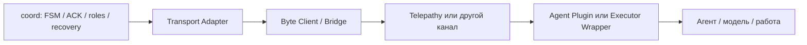

# Telepathy, plugin и coord

`coord` развивает **стек координации поверх транспорта**. Он не является fork
Telepathy и не заменяет доставку сообщений. Зависимости от Telepathy в go.mod нет.

## Когда нужен Telepathy

| Сценарий | Требование |
|---|---|
| Локальное демо и unit tests | In-process/fake transport; Telepathy не нужен |
| Существующие Telepathy-сессии | Реальный Telepathy bridge, реализующий `transport.Client` |
| Агент с поддержкой plugin | Plugin/bridge доставляет envelopes, executor wrapper реализует application protocol |
| Агент без plugin | Внешний wrapper использует доступный агенту stdin/API/file/другой канал |
| Другой транспорт | Своя реализация Transport либо byte Client; ядро остаётся тем же |

Общий bridge может работать с разными агентскими frontend, если у них есть
доступный способ получать задачи и возвращать сообщения. Это вариант архитектуры,
а не утверждение, что установленный Telepathy уже предоставляет такие API.
Фактический способ подключения проверяется для каждой установки.

## Уровни совместимости

Эта таблица описывает требования `coord`, а не официальные уровни Telepathy plugin.

| Уровень | Что умеет агент/его wrapper | Что может coordinator |
|---|---|---|
| 0 | Нет двустороннего канала | Не назначать автоматические задачи |
| 1 | Доставка текстовых сообщений | Проверять канал, но не считать задачу принятой |
| 2 | Валидные TASK и ACK с correlation | Фиксировать acceptance и контролировать ACK timeout |
| 3 | Heartbeat, RESULT/RESULT_ACK, identity, deduplication | Вести рабочий lifecycle и принимать результаты |
| 4 | Checkpoint, writer lock, ABORT, fenced recovery | Восстанавливать работу при выполнении supervisor contract |

Ping/pong и перечисление профиля сами по себе не означают уровень 3 или 4.
Именно wrapper должен превращать сообщения в события протокола, сохранять
checkpoint, предотвращать повторное исполнение и прекращать writer при fencing.
Названия модели и capabilities не доказывают фактическую поддержку этих операций.

## Что уже реализовано

В проекте есть transport interface, generic byte Adapter, SignedClient, валидатор
envelopes, executor helpers и watchdog interface/CLI. Добавлен stdio MCP bridge для Telepathy 0.8.0 и standalone host/worker CLI;
настройка и ограничения — в [TELEPATHY_HOST.md](TELEPATHY_HOST.md).
Подключение произвольной живой LLM-сессии требует собственного frontend wrapper.

Для подключения потребуются:

1. Проверить реальный API отправки/получения и семантику delivery подтверждения.
2. Реализовать `Client.Send` и `Client.Incoming`, соблюдая context и channel closure.
3. Подключить executor wrapper к агенту и определить supported protocol operations.
4. Настроить identities, pinned keys, profiles и supervisor commands.
5. Проверить полный lifecycle и recovery между реальными процессами.

Так `coord` можно использовать и с Telepathy, и с другим транспортом, сохранив
одно ядро FSM и одинаковые проверки восстановления.

RESULT_ACK передаётся в executor.Receipt и подтверждает durable commit, а не
доставку. Старые strict decoders его не понимают: coordinator и wrapper/bridge
обновляются вместе. Полные инструкции подключения — в AGENT_INSTRUCTIONS.md.
