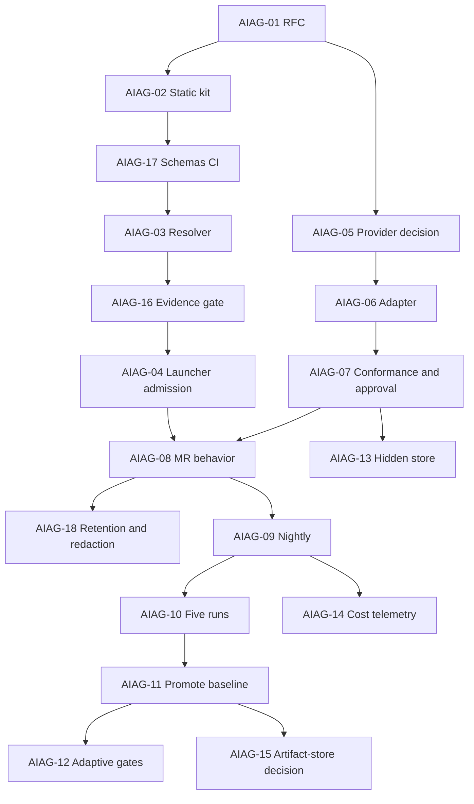

# GitLab work plan: AI Agent Governance

## Initiative

**Title:** AI Agent Governance and Behavioral Evaluation  
**Goal:** принять RFC-0002 и последовательно внедрить static governance, resolver/admission, approved model adapter, behavioral evaluation, promoted baseline и hardening.

> Если доступны GitLab Epics, создайте один верхнеуровневый Epic и дочерние Epics по milestones ниже. Если Epics недоступны, используйте milestones и labels с теми же идентификаторами.

## Milestones / child epics

| ID | Название | Exit criterion |
|---|---|---|
| M0 | Governance decision | RFC-0002 принят, scope и authority зафиксированы |
| M1 | Static governance | Registry, Action Map, schemas и static CI обязательны |
| M2 | Resolver and admission | Контекст выбирается программно, invalid admission блокирует запуск |
| M3 | Approved model adapter | Provider adapter имеет digest, conformance, Review и Audit |
| M4 | Behavioral evaluation | MR и nightly профили дают независимый verdict |
| M5 | Behavioral baseline | Пять runs, accepted current.json, adaptive gates blocking |
| M6 | Hardening and economics | Hidden cases, retention, costs и artifact-store decision |

## Dependency graph



## Issue summary

| ID | Title | Milestone | Class | Priority | Blocked by |
|---|---|---|---|---|---|
| AIAG-01 | Принять RFC-0002 и зафиксировать нормативный scope | M0-governance | R | P0 | - |
| AIAG-02 | Интегрировать static governance kit | M1-static | FD | P0 | AIAG-01 |
| AIAG-03 | Реализовать ActionContext resolver | M2-admission | TD-R2 | P0 | AIAG-02 |
| AIAG-04 | Реализовать launcher admission | M2-admission | TD-R2 | P0 | AIAG-03 |
| AIAG-05 | Выбрать provider/frontend и credentials boundary | M3-adapter | R | P0 | AIAG-01 |
| AIAG-06 | Реализовать model adapter v1 | M3-adapter | TD-R2 | P0 | AIAG-05 |
| AIAG-07 | Выполнить adapter conformance, Review и Audit | M3-adapter | TD-R2 | P0 | AIAG-06 |
| AIAG-08 | Подключить behavioral MR profile | M4-behavior | TD-R2 | P0 | AIAG-04;AIAG-07 |
| AIAG-09 | Подключить nightly evaluation profile | M4-behavior | TD | P1 | AIAG-08 |
| AIAG-10 | Накопить пять совместимых baseline runs | M5-baseline | FD | P1 | AIAG-09 |
| AIAG-11 | Сформировать и принять behavioral baseline | M5-baseline | TD-R2 | P1 | AIAG-10 |
| AIAG-12 | Включить adaptive blocking gates | M5-baseline | TD | P1 | AIAG-11 |
| AIAG-13 | Настроить защищённое hidden-case хранилище | M6-hardening | TD-R2 | P1 | AIAG-07 |
| AIAG-14 | Включить token и cost telemetry | M6-hardening | TD | P2 | AIAG-07;AIAG-09 |
| AIAG-15 | Принять решение по внешнему artifact store | M6-hardening | R | P2 | AIAG-11 |
| AIAG-16 | Добавить EvidenceRecord gate | M2-admission | TD-R2 | P0 | AIAG-03 |
| AIAG-17 | Добавить schemas и conformance CI | M1-static | TD | P0 | AIAG-02 |
| AIAG-18 | Внедрить retention и redaction gate | M4-behavior | TD-R2 | P1 | AIAG-08 |

## Cross-cutting Definition of Ready

- owning norm and current status identified;
- decision class recorded;
- base SHA and WorkspaceBinding fixed;
- allowed/read-only/prohibited paths fixed;
- expected outputs and stop conditions fixed;
- Reviewer assigned;
- Auditor assigned for TD-R2;
- OWNER boundary recorded for class R;
- architecture and document impact declared;
- no unresolved predecessor dependency.

## Cross-cutting Definition of Done

- implementation and required documents committed to exact subject;
- positive, negative and mutation tests pass;
- `make check` runs through the approved project-local wrapper;
- `git diff --check` and staged-scope review pass;
- ReviewResult binds to exact subject;
- AuditResult or justified N/A binds to exact subject;
- Architecture Sync passes where applicable;
- CI passes on integrated SHA;
- CURRENT, OPEN-WORK, Operations Ledger and Completion Report updated;
- no hard metric violations;
- `NOT_EVALUATED` remains explicit and never counts as PASS.

## Recommended labels

```text
ai-agent-governance
type::feature
type::policy
type::security
priority::p0
priority::p1
priority::p2
decision::fd
decision::td
decision::td-r2
decision::r
status::blocked
status::ready
status::in-progress
status::review
status::done
gate::review
gate::audit
gate::owner
area::registry
area::action-map
area::resolver
area::adapter
area::evaluation
area::baseline
area::hidden-cases
area::cost
area::artifacts
```

## Board columns

```text
Open
Ready
In Progress
Review
Audit
Owner Decision
Blocked External
Ready for Commit
Integrated
Closed
```

## Milestone admission

A milestone starts only when all predecessor milestones have met their exit criteria. M3 can proceed in parallel with M2 after RFC acceptance. M4 requires both admission and approved adapter. M5 requires real behavioral evaluation. M6 tasks may start selectively, but hidden cases and cost telemetry remain NOT_EVALUATED until their external inputs exist.

## Priority and estimate matrix

| ID | Priority | GitLab weight | Complexity range |
|---|---:|---:|---:|
| AIAG-01 | P0 | 3 | 3-5 |
| AIAG-02 | P0 | 5 | 5-8 |
| AIAG-03 | P0 | 8 | 8-13 |
| AIAG-04 | P0 | 8 | 8-13 |
| AIAG-05 | P0 | 3 | 3-8 |
| AIAG-06 | P0 | 13 | 13-21 |
| AIAG-07 | P0 | 8 | 8-13 |
| AIAG-08 | P0 | 8 | 8-13 |
| AIAG-09 | P1 | 5 | 5-8 |
| AIAG-10 | P1 | 3 | 3-5 |
| AIAG-11 | P1 | 5 | 5-8 |
| AIAG-12 | P1 | 5 | 5-8 |
| AIAG-13 | P1 | 8 | 8-13 |
| AIAG-14 | P2 | 5 | 5-8 |
| AIAG-15 | P2 | 3 | 3-8 |
| AIAG-16 | P0 | 8 | 8-13 |
| AIAG-17 | P0 | 5 | 5-8 |
| AIAG-18 | P1 | 8 | 8-13 |

Weights are relative complexity points, not calendar duration. See `PRIORITY-AND-ESTIMATION.md`.
