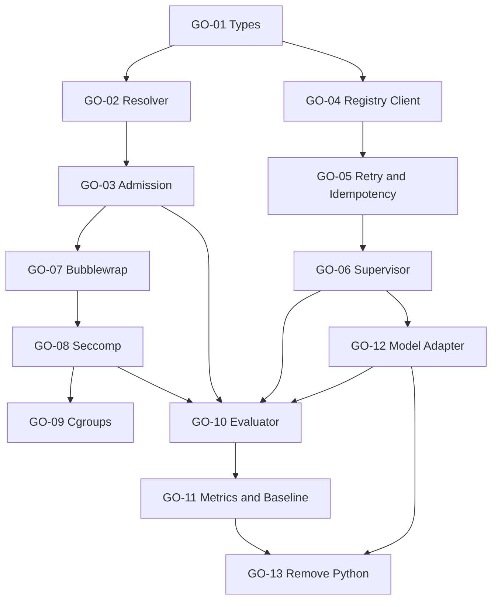

# План полной миграции AI Agent Governance в Go

## Статус

```yaml
documentStatus: Proposed migration plan
productionLanguage: Go
pythonProductionUse: prohibited
pythonPrototypeUse:
  - reference fixtures
  - behavior oracle during migration
  - temporary mock server only until Go replacement lands
normativeAuthority: false
ownerAcceptanceRequired: true
```

## 1. Цель

Перенести resolver, admission, launcher, AgentSession Registry client,
Supervisor, Linux sandbox, seccomp, behavioral evaluator, metrics и baseline
commands в основной Go-код `coord`.

После миграции production path не должен требовать Python, PyYAML,
`python3-seccomp` или запуск Python scripts.

## 2. Целевой runtime path

```text
coord
→ resolve ActionContext
→ validate AgentBootstrap
→ AgentSession Registry Admit
→ start Supervisor
→ create Linux sandbox
→ apply seccomp
→ execute approved model/process adapter
→ heartbeat with idempotency and retry
→ fence local process tree on invalid lease/generation/status
→ report Complete/Fence
→ evaluate structured result
→ emit metrics and evidence
```

## 3. Целевая структура Go-пакетов

```text
cmd/
├── coord/
└── coord-agent-helper/

internal/
├── actioncontext/
│   ├── model.go
│   ├── resolver.go
│   ├── authority.go
│   ├── budget.go
│   ├── digest.go
│   └── resolver_test.go
├── admission/
│   ├── bootstrap.go
│   ├── validator.go
│   ├── errors.go
│   └── validator_test.go
├── agentsession/
│   ├── model.go
│   ├── registry.go
│   ├── openapi_client.go
│   ├── retry.go
│   ├── idempotency.go
│   ├── fake_registry_test.go
│   └── client_test.go
├── supervisor/
│   ├── supervisor.go
│   ├── heartbeat.go
│   ├── lifecycle.go
│   ├── process_unix.go
│   ├── process_other.go
│   └── supervisor_test.go
├── sandbox/
│   ├── profile.go
│   ├── backend.go
│   ├── bubblewrap_linux.go
│   ├── seccomp_linux.go
│   ├── unsupported.go
│   └── sandbox_test.go
├── evaluation/
│   ├── scenario.go
│   ├── runner.go
│   ├── evaluator.go
│   ├── metrics.go
│   └── evaluator_test.go
├── baseline/
│   ├── store.go
│   ├── compare.go
│   ├── promote.go
│   └── baseline_test.go
└── governanceio/
    ├── yaml.go
    ├── json.go
    ├── schema.go
    └── atomic.go
```

## 4. Технологические правила

1. Production logic пишется на Go.
2. Внешние команды запускаются через `os/exec` без shell.
3. Для executable используется абсолютный path.
4. Linux-specific код отделяется через `//go:build linux`.
5. Unsupported OS возвращает fail-closed error.
6. Все публичные контракты имеют Go types и JSON/YAML tags.
7. Registry client генерируется из принятого canonical OpenAPI либо вручную
   реализует тот же typed contract с contract tests.
8. Seccomp использует `github.com/seccomp/libseccomp-golang` только в Linux+cgo
   build; отсутствие backend блокирует production admission.
9. Python scripts не вызываются из Go production binary.
10. Временные файлы создаются только внутри `workspace-NN/.scratch/tmp`.

## 5. Этапы миграции

### GO-01. Зафиксировать типы и error taxonomy

**Приоритет:** P0  
**Weight:** 5  
**Decision class:** TD

Реализовать Go-типы:

```text
ActionContext
DocumentBinding
AuthorityRejection
Transition
ContextBudget
Admission
AgentBootstrap
WorkspaceBinding
EvidenceRecord
AgentWorkResult
```

Error codes должны быть стабильными:

```text
UNKNOWN_EVENT
DOCUMENT_UNREGISTERED
REQUIRED_DOCUMENT_MISSING
AUTHORITY_VIOLATION
CONTEXT_BUDGET_EXCEEDED
SUBJECT_BINDING_MISSING
INVALID_ADMISSION
BASE_SHA_MISMATCH
WORKSPACE_BINDING_INVALID
```

**Done:** round-trip JSON/YAML tests, unknown fields policy, fixtures совместимы
с утверждёнными schemas.

### GO-02. Перенести ActionContext resolver

**Приоритет:** P0  
**Weight:** 8  
**Decision class:** TD-R2

Вход:

```go
type ResolveRequest struct {
    ProjectID             string
    Role                  Role
    Event                 Event
    AssignmentID          string
    BaseSHA               string
    OwningDocumentIDs     []string
    AdditionalDocumentIDs []string
}
```

Resolver обязан:

- найти event в machine-readable Action Map;
- разрешить document IDs через Registry;
- проверить `readWhen` и authority;
- вычислить SHA-256;
- применить role budget;
- вернуть `ADMITTED` или `INVALID_ADMISSION`;
- не выполнять I/O вне ProjectRoot.

**Negative tests:** unknown event, missing document, historical/current misuse,
legacy/canonical misuse, Proposed/Accepted misuse, path escape, budget overflow,
digest drift.

### GO-03. Перенести bootstrap и launcher admission

**Приоритет:** P0  
**Weight:** 8  
**Decision class:** TD-R2

Launcher проверяет:

```text
bootstrap schema
assignment identity
ProjectRoot / RepositoryRoot / Worktree containment
launch cwd equals ProjectRoot
base SHA
selected-document digests
tool allowlist
side-effect policy
ActionContext admission
```

Launcher по умолчанию выполняет dry-run. Реальный запуск требует явного режима.

### GO-04. Реализовать typed AgentSession Registry client

**Приоритет:** P0  
**Weight:** 13  
**Decision class:** TD-R2

Интерфейс:

```go
type Registry interface {
    Admit(context.Context, AdmitRequest) (Session, error)
    Heartbeat(context.Context, HeartbeatRequest) (HeartbeatResult, error)
    Complete(context.Context, CompleteRequest) error
    Fence(context.Context, FenceRequest) error
}
```

Требования:

- bearer/job credential только из protected environment/credential provider;
- canonical OpenAPI digest фиксируется;
- typed request/response;
- TLS verification;
- operation timeout;
- no credentials in logs/artifacts;
- fake Registry для unit tests;
- contract tests против реального Registry.

**Blocker:** canonical OpenAPI mapping должен дать PASS.

### GO-05. Retry и heartbeat idempotency

**Приоритет:** P0  
**Weight:** 8  
**Decision class:** TD-R2

Идемпотентный ключ:

```text
SHA-256(
  operation,
  ProjectID,
  AssignmentID,
  SessionID,
  Generation,
  HeartbeatSequence,
  LeaseTokenDigest
)
```

Правила:

- key одинаков на всех retry одного logical request;
- heartbeat sequence монотонен;
- retry только для утверждённых transient statuses и transport errors;
- bounded exponential backoff + jitter;
- `Retry-After` поддерживается;
- retry exhaustion возвращает `NOT_EVALUATED`/terminal error;
- server duplicate response проверяется на binding consistency.

**Server contract tests:** duplicate same body, same key/different body, stale
sequence, skipped sequence, response loss after commit.

### GO-06. Supervisor lifecycle

**Приоритет:** P0  
**Weight:** 13  
**Decision class:** TD-R2

Supervisor использует `context.Context`, `time.Ticker`, `os/exec`, signal
handling и injected Clock/Registry/Process interfaces.

Состояния:

```text
NEW
ADMITTED
RUNNING
FENCING
COMPLETING
COMPLETED
FAILED
```

Fencing triggers:

```text
Registry FENCED/REVOKED/EXPIRED/REJECTED
generation mismatch
lease digest mismatch
heartbeat failure limit
malformed response
local sandbox violation
context cancellation
```

Supervisor обязан:

- запускать process group;
- SIGTERM group;
- после timeout SIGKILL group;
- вызывать Registry Fence при локальном нарушении;
- вызывать Complete при завершении;
- сохранять atomic receipt;
- обрабатывать SIGTERM/SIGINT и panic path;
- не очищать ownership вместо fencing.

### GO-07. Linux Bubblewrap backend

**Приоритет:** P0  
**Weight:** 8  
**Decision class:** TD-R2

Файл:

```go
//go:build linux
```

Backend строит argv для `bwrap` без shell:

```text
user/pid/ipc/uts/cgroup/network namespaces
read-only repository
writable assigned worktree
project-local scratch
private ephemeral /tmp
cleared environment
absolute executable path
```

При отсутствии `bwrap`, user namespaces или required capability production
profile возвращает `INVALID_ADMISSION`.

### GO-08. Linux seccomp backend

**Приоритет:** P0  
**Weight:** 13  
**Decision class:** TD-R2

Использовать Go bindings к libseccomp. Реализацию отделить build tags:

```go
//go:build linux && cgo
```

Fallback:

```go
//go:build !linux || !cgo
```

Fallback всегда возвращает unsupported/fail-closed для production profile.

Начать с разных профилей:

```text
executor-go-v1
coordinator-go-v1
reviewer-readonly-v1
auditor-readonly-v1
```

Обязательные live tests:

```text
allowed file operations pass
ptrace denied
mount denied
bpf denied
setns/unshare denied
network blocked by namespace policy
adapter binary starts under final profile
```

### GO-09. Cgroup enforcement

**Приоритет:** P1  
**Weight:** 8  
**Decision class:** TD-R2

Backend выбирается явно:

```text
systemd transient unit
или runner/container cgroup contract
```

Ограничения:

```text
memory.max
memory.swap.max
cpu.max
pids.max
```

Нет backend в production profile означает отказ, не silent downgrade.

### GO-10. Behavioral evaluator

**Приоритет:** P0  
**Weight:** 13  
**Decision class:** TD-R2

Evaluator независимо вычисляет verdict и не доверяет `status: PASS` модели.

Проверяет:

```text
selected event
required/missing documents
authority rejection
required/forbidden actions
expected result
OWNER/HUMAN classification
subject SHA
evidence eligibility
context budget
side-effect absence
```

### GO-11. Metrics и baseline commands

**Приоритет:** P1  
**Weight:** 8  
**Decision class:** TD

Перенести на Go:

```text
collect metrics
check hard gates
compare baseline
store append-only run
promote candidate
validate baseline store
emit JUnit/OpenMetrics/dotenv
```

Команды должны быть subcommands `coord governance ...`, а не отдельными Python
scripts.

### GO-12. Provider-specific model adapter interface

**Приоритет:** P0  
**Weight:** 13–21  
**Decision class:** R + TD-R2

Сначала OWNER выбирает provider/local frontend и credential/data boundary.
Затем реализуется Go adapter либо утверждённый внешний executable с typed Go
wrapper.

Без approved adapter behavioral evaluation остаётся `NOT_EVALUATED`.

### GO-13. Удалить Python из production path

**Приоритет:** P1  
**Weight:** 5  
**Decision class:** FD

Условия удаления:

- Go resolver parity PASS;
- Go launcher parity PASS;
- Registry/Supervisor parity PASS;
- sandbox/seccomp conformance PASS;
- evaluator parity PASS;
- baseline tooling parity PASS;
- GitLab CI не устанавливает Python для production governance jobs.

Python fixtures можно оставить только в `testdata/reference-python/` с явным
`productionUse: prohibited`, либо удалить полностью.

## 6. Порядок зависимостей



Параллельные ветви после `GO-01`:

```text
Resolver/admission
Registry/Supervisor
Sandbox/seccomp
```

Они сходятся перед behavioral evaluation.

## 7. Переходная стратегия без двойной authority

Python и Go не должны одновременно считаться authoritative.

### Phase A: Python как reference oracle

```yaml
goProductionEnabled: false
pythonReferenceEnabled: true
comparisonMode: fixtures_only
```

Одинаковые fixtures подаются в Python и Go. Сравниваются только structured
outputs и error codes.

### Phase B: Go shadow mode

```yaml
goProductionEnabled: false
goShadowEvaluation: true
pythonMutationAuthority: false
```

Go вычисляет результаты параллельно, но не запускает реальные side effects.

### Phase C: Go primary

```yaml
goProductionEnabled: true
pythonProductionEnabled: false
rollbackTarget: previous_go_binary
```

Rollback выполняется на предыдущий принятый Go binary, не на Python path.

### Phase D: Python retirement

Python удаляется из production image, CI install steps и operational docs.

## 8. CI после миграции

Основной gate:

```bash
go test ./...
go test -race ./...
go vet ./...
gofmt -l .
git diff --check
```

Linux security jobs:

```bash
go test -tags 'linux,cgo,seccomp' ./internal/sandbox/...
go test -run TestBubblewrapIntegration ./internal/sandbox/...
go test -run TestSupervisorFence ./internal/supervisor/...
go test -run TestRegistryContract ./internal/agentsession/...
```

Release build:

```bash
CGO_ENABLED=1 GOOS=linux go build -trimpath -o dist/coord ./cmd/coord
sha256sum dist/coord
```

Binary digest, Go version, module graph and canonical OpenAPI digest включаются
в build provenance.

## 9. Definition of Ready для каждой Go-задачи

- owning package и current implementation найдены;
- exact base SHA записан;
- canonical contracts доступны;
- allowed paths и test fixtures указаны;
- expected negative cases указаны;
- Reviewer назначен;
- Auditor назначен для TD-R2;
- внешние зависимости не скрыты;
- Python reference не объявлен normative source.

## 10. Definition of Done всей миграции

```yaml
migrationComplete:
  actionContextResolverGo: true
  launcherAdmissionGo: true
  registryClientGo: true
  heartbeatRetryIdempotencyGo: true
  supervisorGo: true
  bubblewrapBackendGo: true
  seccompBackendGo: true
  behavioralEvaluatorGo: true
  metricsAndBaselineGo: true
  approvedModelAdapter: true
  canonicalOpenApiMappingPass: true
  liveLinuxIsolationPass: true
  serverSideIdempotencyPass: true
  promotedBaselinePresent: true
  pythonInProductionPath: false
  rfcAccepted: true
```

## 11. Что не переносится автоматически

Следующие пункты требуют реальных внешних входов:

- canonical AgentSession OpenAPI;
- принятой semantics Registry revision;
- server-side idempotency;
- provider/model decision;
- credentials boundary;
- Linux runner с Bubblewrap, cgroups и libseccomp;
- AppArmor/SELinux policy при обязательности MAC;
- protected hidden-case store;
- пять реальных behavioral runs.

Их отсутствие даёт `NOT_EVALUATED` или `BLOCKED_EXTERNAL`, не `PASS`.

## 12. Обновлённая матрица GitLab Issues

| ID | Название | Priority | Weight | Blocked by |
|---|---|---:|---:|---|
| GO-01 | Go types и error taxonomy | P0 | 5 | RFC acceptance |
| GO-02 | Go ActionContext resolver | P0 | 8 | GO-01 |
| GO-03 | Go bootstrap и launcher admission | P0 | 8 | GO-02 |
| GO-04 | Go AgentSession Registry client | P0 | 13 | GO-01, canonical OpenAPI |
| GO-05 | Retry и heartbeat idempotency | P0 | 8 | GO-04 |
| GO-06 | Supervisor lifecycle и fencing | P0 | 13 | GO-05 |
| GO-07 | Linux Bubblewrap backend | P0 | 8 | GO-03 |
| GO-08 | Linux seccomp backend | P0 | 13 | GO-07 |
| GO-09 | Cgroup enforcement | P1 | 8 | GO-07 |
| GO-10 | Deterministic behavioral evaluator | P0 | 13 | GO-03, GO-06, GO-08 |
| GO-11 | Metrics и baseline commands | P1 | 8 | GO-10 |
| GO-12 | Provider-specific model adapter | P0 | 13–21 | OWNER provider decision, GO-06 |
| GO-13 | Remove Python from production path | P1 | 5 | GO-11, GO-12 |

## 13. Немедленный следующий шаг

Первый implementation slice:

```text
GO-01
→ GO-02
→ GO-03
```

Он не зависит от provider и позволяет немедленно заменить Python resolver и
launcher typed Go-кодом. Параллельно после получения canonical OpenAPI можно
начинать `GO-04`.
